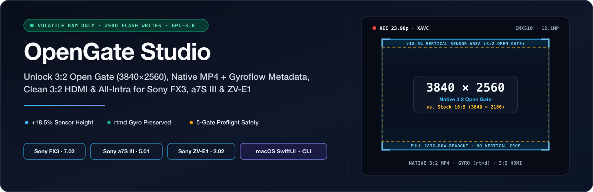
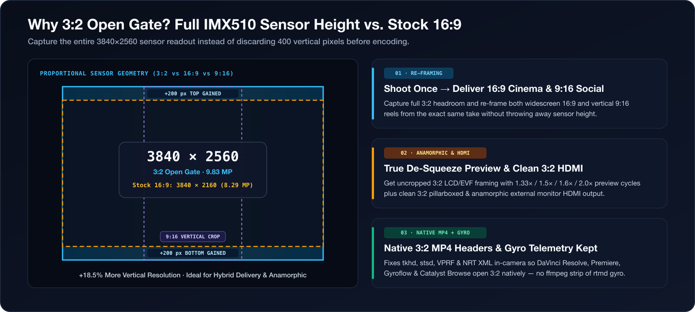
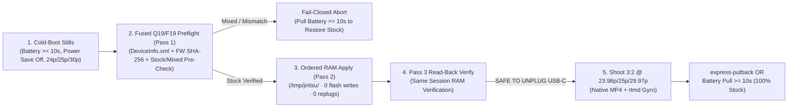

<div align="center">

<a href="https://github.com/jeromykovatana/opengate-studio">
  
</a>

<h1>OpenGate Studio</h1>

<p><strong>Unlock 3:2 Open Gate (3840×2560) in volatile camera RAM for Sony FX3, a7S III, and ZV-E1 — with fail-closed preflight binding, native 3:2 MP4 container patches, and Sony <code>rtmd</code> gyro track preservation.</strong></p>

<p>
  <a href="https://github.com/jeromykovatana/opengate-studio/releases"></a>
  <a href="https://github.com/jeromykovatana/opengate-studio/actions/workflows/ci.yml"></a>
  
  
  
  <a href="LICENSE"></a>
</p>

<p>
  <a href="https://github.com/jeromykovatana/opengate-studio/releases"><strong>Download macOS App</strong></a> ·
  <a href="#why-opengate-studio">Why Open Gate</a> ·
  <a href="#supported-cameras--firmware-pins">Supported Cameras</a> ·
  <a href="#modular-feature-packs">Feature Packs</a> ·
  <a href="#5-gate-volatile-ram-safety-architecture">Safety Architecture</a> ·
  <a href="#quick-start">Quick Start</a> ·
  <a href="#faq">FAQ</a> ·
  <a href="docs/OFFICE_CAMERA_TEST_GUIDE.md">Field Test Guide</a>
</p>

</div>

---

> [!WARNING]
> **READ BEFORE USE — ALPHA PRE-RELEASE / VOLATILE RAM ONLY / AS-IS (GPL-3.0)**
> - **100% VOLATILE RAM ONLY (`persistent_writes: false`):** Every patch runs in temporary camera RAM (`/tmp/jiritsu/`). **Zero bytes** are written to eMMC flash (`nflasha*`), `boot0`/`boot1`, or `BK4` settings. **Pulling the battery for ≥ 10 seconds restores 100% stock firmware state.**
> - **READ-ONLY PREFLIGHT FIRST:** Never apply patches until the read-only preflight returns **`VERDICT READY`** on your exact pinned firmware version (`ZV-E1 2.02`, `a7S III 5.01`, or `FX3 7.02`).
> - **`24p` (`23.98p`), `25p` (PAL), or `30p` (`29.97p`) ONLY WHILE APPLIED:** Shoot only at `24p` (`23.976p`), `25p` (`PAL`, drive mode `0x820`), or `30p` (`29.97p`) in `XAVC HS 4K`, `XAVC S 4K`, or `XAVC S-I 4K`. Switching to `50p`, `60p`, or `120p` under `3840×2560` open gate exceeds the `IMX510` readout ceiling and crashes the camera.
> - **PROVIDED AS-IS WITHOUT WARRANTY OF ANY KIND (GPL-3.0-or-later).** You can explore the entire macOS app and CLI offline in **Mock Camera Mode** before ever plugging in a camera.

---

## Why OpenGate Studio?

Sony's 12.1MP full-frame sensor (`IMX510` + `CXD90057` BIONZ XR) physically reads out 3:2 rows, yet stock firmware crops the frame vertically to 16:9 (`3840×2160`) before encoding. **OpenGate Studio** (`v0.3.1-alpha` 1-Click Express release) unlocks the full **3:2 (`3840×2560`)** sensor height—alongside native 3:2 MP4 headers that preserve Sony's `rtmd` gyro track, plus experimental HDMI/high-bitrate/All-Intra packs—via a 1-click macOS SwiftUI app, an Android USB-OTG field companion APK, and a clean-room Python CLI.

<div align="center">
  
</div>

### How It Compares

| Capability | Stock Sony Firmware | Basic Open-Gate Script | **OpenGate Studio (`v0.3.1-alpha`)** |
|---|---|---|---|
| **3:2 Full Sensor (`3840×2560`)** | ❌ Cropped to `3840×2160` (`16:9`) | ✅ `23.98p` (+ FX3 `25p`) | ✅ `23.98p` HW core across 3 bodies (+ FX3 `25p`); `25p`/`29.97p` & `a7C`/`ZV-E10` (`Emu ✅`) |
| **1-Click Express Apply** | — | Manual multi-step scripts + replugs | ✅ **1-Click Single-Pass Express Apply (~10s, 0 cable replugs, no Movie-mode replug)** |
| **Native `3:2` MP4 + `rtmd` Gyro** | ✅ `16:9` clips only | ❌ Stripped if `ffmpeg` re-muxed | ✅ **Hardware-verified on ZV-E1 `2.02` `23.98p` + Gyroflow `12.336ms`** (a7S III/FX3 `Emu ✅`) |
| **Clean 3:2 & Anamorphic HDMI (`hdmi32`)** | ❌ `16:9` cropped HDMI | ❌ Not included | 🧪 Experimental (`H16`/`H17`, byte + emulator ✅, HW pending) |
| **High-Bitrate `200M/300M` & `XAVC S-I` All-Intra** | ❌ `16:9` only | ❌ Stock `100M` Long-GOP only | 🧪 Experimental (`high_bitrate` & `xavc_si`, byte + emulator ✅, HW pending) |
| **Safety & Fail-Closed Preflight** | — | Manual script order | ✅ **Single-Session `DeviceInfo.xml` + FW SHA-256 + 16B Guards + Read-Back Verify** |
| **Clip, XML & Gyro Inspector** | ❌ None | ❌ None | ✅ Built-in SwiftUI & CLI `bionz_clip_check.py` (10/10 synthetic fixtures + ZV-E1 HW clip) |
| **macOS Setup Experience** | — | Manual Python + scripts | ✅ **Live IOKit USB Auto-Detection + macOS 14–27 `sudo` / Touch ID** (no Zadig/Homebrew `libusb`) |
| **Mobile Field Companion** | — | ❌ Laptop required on set | ✅ **1-Tap Android USB-OTG Companion APK** (re-apply on set after any battery swap) |

---

## Supported Cameras, Firmware Pins & Evidence Matrix

All 90 `.so` helper binaries across 5 bodies in `kits/` are compiled reproducibly with `ziglang 0.13.0` (`clang 18.1.6`), pinned by SHA-256, and verified in Unicorn AArch64 / ARM32 emulation (`0` clean-room violations). **Recommended profile for field use: `Safe Daily 3:2` (`core_open_gate` + `mp4_3x2` + `screen_3x2`).**

<!-- BEGIN GENERATED SUPPORT MATRIX -->
### Supported Bodies & Pinned Firmware (`v0.3.1-alpha (1-Click Express Release)`)

| Camera Body | Model ID | Pinned Firmware | `body_id` | Build ID (`version.txt`) | Pinned Helpers | Evidence Summary |
|---|---|---|---|---|---:|---|
| **Sony ZV-E1** | `ZV-E1` | **`2.02`** | `zve1_202` | `32000_08.2025101101` | 26 `.so` | Bytes + Emu ✅ · `23.98p` + SteadyShot HW ✅ · `25p`/`29.97p`/Experimental ⬜ |
| **Sony a7S III** | `ILCE-7SM3` | **`5.01`** | `a7s3_501` | `39183_16.2026041504` | 24 `.so` | Bytes + Emu ✅ · `23.98p` HW ✅ · `25p`/`29.97p`/Experimental ⬜ |
| **Sony FX3** | `ILME-FX3 (not FX3A)` | **`7.02`** | `fx3_702` | `39180_21.2025122503` | 24 `.so` | Bytes + Emu ✅ · `23.98p` + PAL `25p` + 4:3 panel HW ✅ · `29.97p`/Experimental ⬜ |
| **Sony a7C** | `ILCE-7C` | **`2.03`** | `a7c_203` | `39119_08.2026013101` | 8 `.so` | Bytes + ARM32 Emu ✅ · `23.98p` squeezed 3:2 + `raster_2560` awaiting HW test ⬜ |
| **Sony ZV-E10** | `ZV-E10` | **`2.03`** | `zve10_203` | `30110_06.2026060501` | 8 `.so` | Bytes + ARM32 Emu ✅ · `23.98p` squeezed 3:2 + `raster_2560` awaiting HW test ⬜ |

### Granular Evidence Summary (Generated from [`docs/support_matrix.json`](docs/support_matrix.json))

| Body | FPS | Pack | Tier | Bytes | Emu | HW Rec | MP4/XML | Gyroflow | Catalyst | NLE | Playback | Soak | Field Ready |
|---|---|---|---|---|---|---|---|---|---|---|---|---|---|
| `zve1_202` | `23.98p` | `core_open_gate + screen_3x2` | `recommended` | ✅ | ✅ | ✅ | ✅ | ✅ | ⬜ | ⬜ | ⬜ | ⬜ | ⬜ |
| `zve1_202` | `23.98p` | `mp4_3x2` | `recommended` | ✅ | ✅ | ✅ | ✅ | ✅ | ⬜ | ⬜ | ⬜ | ⬜ | ⬜ |
| `zve1_202` | `25p / 29.97p` | `core_open_gate + mp4_3x2` | `experimental` | ✅ | ✅ | ⬜ | ⬜ | ⬜ | ⬜ | ⬜ | ⬜ | ⬜ | ⬜ |
| `zve1_202` | `23.98p / 25p / 29.97p` | `hdmi32` | `experimental` | ✅ | ✅ | ⬜ | ⬜ | — | — | — | — | ⬜ | ⬜ |
| `zve1_202` | `23.98p / 25p` | `high_bitrate` | `experimental` | ✅ | ✅ | ⬜ | ⬜ | ⬜ | ⬜ | ⬜ | ⬜ | ⬜ | ⬜ |
| `zve1_202` | `23.98p / 25p / 29.97p` | `xavc_si` | `experimental` | ✅ | ✅ | ⬜ | ⬜ | ⬜ | ⬜ | ⬜ | ⬜ | ⬜ | ⬜ |
| `a7s3_501` | `23.98p` | `core_open_gate + screen_3x2` | `recommended` | ✅ | ✅ | ✅ | ⬜ | ⬜ | ⬜ | ⬜ | ⬜ | ⬜ | ⬜ |
| `a7s3_501` | `23.98p` | `mp4_3x2` | `recommended` | ✅ | ✅ | 🟡 | ⬜ | ⬜ | ⬜ | ⬜ | ⬜ | ⬜ | ⬜ |
| `a7s3_501` | `25p / 29.97p` | `core_open_gate + mp4_3x2` | `experimental` | ✅ | ✅ | ⬜ | ⬜ | ⬜ | ⬜ | ⬜ | ⬜ | ⬜ | ⬜ |
| `a7s3_501` | `23.98p / 25p / 29.97p` | `hdmi32` | `experimental` | ✅ | ✅ | ⬜ | ⬜ | — | — | — | — | ⬜ | ⬜ |
| `a7s3_501` | `23.98p / 25p` | `high_bitrate` | `experimental` | ✅ | ✅ | ⬜ | ⬜ | ⬜ | ⬜ | ⬜ | ⬜ | ⬜ | ⬜ |
| `a7s3_501` | `23.98p / 25p / 29.97p` | `xavc_si` | `experimental` | ✅ | ✅ | ⬜ | ⬜ | ⬜ | ⬜ | ⬜ | ⬜ | ⬜ | ⬜ |
| `fx3_702` | `23.98p / 25p (PAL)` | `core_open_gate + screen_3x2` | `recommended` | ✅ | ✅ | ✅ | ⬜ | ⬜ | ⬜ | ⬜ | ⬜ | ⬜ | ⬜ |
| `fx3_702` | `23.98p / 25p (PAL)` | `mp4_3x2` | `recommended` | ✅ | ✅ | 🟡 | ⬜ | ⬜ | ⬜ | ⬜ | ⬜ | ⬜ | ⬜ |
| `fx3_702` | `29.97p` | `core_open_gate + mp4_3x2` | `experimental` | ✅ | ✅ | ⬜ | ⬜ | ⬜ | ⬜ | ⬜ | ⬜ | ⬜ | ⬜ |
| `fx3_702` | `23.98p / 25p / 29.97p` | `hdmi32` | `experimental` | ✅ | ✅ | ⬜ | ⬜ | — | — | — | — | ⬜ | ⬜ |
| `fx3_702` | `23.98p / 25p` | `high_bitrate` | `experimental` | ✅ | ✅ | ⬜ | ⬜ | ⬜ | ⬜ | ⬜ | ⬜ | ⬜ | ⬜ |
| `fx3_702` | `23.98p / 25p / 29.97p` | `xavc_si` | `experimental` | ✅ | ✅ | ⬜ | ⬜ | ⬜ | ⬜ | ⬜ | ⬜ | ⬜ | ⬜ |
| `fx3_702` | `23.98p / 25p / 29.97p` | `fx3_playback` | `experimental` | ✅ | ✅ | ⬜ | — | — | — | — | ⬜ | ⬜ | ⬜ |
| `a7c_203` | `23.98p` | `core_open_gate` | `recommended` | ✅ | ✅ | ⬜ | ⬜ | ⬜ | ⬜ | ⬜ | ⬜ | ⬜ | ⬜ |
| `a7c_203` | `23.98p` | `raster_2560` | `experimental` | ✅ | ✅ | ⬜ | ⬜ | ⬜ | ⬜ | ⬜ | ⬜ | ⬜ | ⬜ |
| `zve10_203` | `23.98p` | `core_open_gate` | `recommended` | ✅ | ✅ | ⬜ | ⬜ | ⬜ | ⬜ | ⬜ | ⬜ | ⬜ | ⬜ |
| `zve10_203` | `23.98p` | `raster_2560` | `experimental` | ✅ | ✅ | ⬜ | ⬜ | ⬜ | ⬜ | ⬜ | ⬜ | ⬜ | ⬜ |

_Legend: ✅ Verified · 🟡 Partial (upstream/architectural evidence; full Studio conformance clip pending) · ⬜ Pending untouched camera original · ⛔ Hardware-blocked · — N/A. See the full matrix including blocked `50p/60p/120p` and `a7iv_602` rows in [docs/SUPPORT_MATRIX.md](docs/SUPPORT_MATRIX.md)._
<!-- END GENERATED SUPPORT MATRIX -->

> [!NOTE]
> - **Exact firmware required:** Only `ZV-E1 2.02`, `a7S III 5.01`, and `FX3 7.02` (`ILME-FX3`, **not** `ILME-FX3A`) are supported. Preflight rejects any mismatched `DeviceInfo.xml` or memory identity page before touching RAM.
> - **Sony a7 IV Clip Support:** The built-in Clip Inspector (`cli/bionz_clip_check.py`) also validates `3840×2560` and `5760×3840` clips from `a7iv-open-gate-test`.
> - **Help validate on hardware:** This project is in active **v0.3.1-alpha** testing. If you run it on hardware, please submit a [Field Test Report](https://github.com/jeromykovatana/opengate-studio/issues/new?template=field-test-report.yml) with untouched camera originals.

---

## Modular Feature Packs

Pick **Safe Daily 3:2 (Recommended)** for the smallest volatile RAM footprint, or toggle optional **Experimental** packs below. Each pack is checked for zero cross-pack guard collisions:

| Pack | Tier | What It Unlocks | Steps | Availability |
|---|---|---|---|---|
| `core_open_gate` | **Required** | Full-height `3840×2560` 3:2 dual NTSC (`0x8c0`) + PAL (`0x820`) `MULTI_REC` readout & output size (`23.98p` HW core; `25p`/`29.97p`, plus `dmmwb` raw buffer resize on ZV-E1) | `L13` *(ZV)* · `L5` · `L16` | ZV-E1, a7S III, FX3 |
| `mp4_3x2` | **Recommended** | Native `3840×2560` MP4 `tkhd`/`stsd`/`VPRF` height, codec level preservation, NRT XML `16:9` suppression, and playback table (`149 av-cam + 12 libmpr`; falls back to `L19`/`L20`) | `V19` / `V20` | ZV-E1, a7S III, FX3 |
| `screen_3x2` | **Recommended** | Full-frame 3:2 LCD/EVF framing & live preview aspect cycle (`3:2 → 2:1 → 2.25:1 → 2.4:1` on C2/C3 for ZV-E1/a7S III; native De-Squeeze calibrated on FX3) | `S16` + `C19` *(ZV/S3)* | ZV-E1, a7S III, FX3 |
| `hdmi32` | **Experimental** | Clean 3:2 pillarboxed & uncropped anamorphic HDMI output for external monitors (`Byte + Emu ✅`, HW pending) | `H16` / `H17` | ZV-E1, a7S III, FX3 |
| `high_bitrate` | **Experimental** | `200M` / `300M` Long-GOP bitrate overlay for `XAVC HS 4K` & `XAVC S 4K` (`Byte + Emu ✅`, soak pending) | `B19` / `B20` | ZV-E1, a7S III, FX3 |
| `xavc_si` | **Experimental** | `XAVC S-I 4K` All-Intra `3840×2560` Open Gate (`23.98p / 25p / 29.97p`) + dual-core row split + VPRF/playback (`Byte + Emu ✅`, HW pending) | `I19` / `I20` | ZV-E1, a7S III, FX3 |
| `fx3_playback` | **Experimental (Off)** | Optional FX3 in-camera 3:2 playback path fix (`avdec8k_fx3_v1`, disabled by default — **untested on hardware**) | `P29` / `P30` | FX3 `7.02` only |

---

## Quick Start

### Option A — 1-Click macOS App (`OpenGate Studio.app` — Recommended)

Requires **macOS 14+** (tested through macOS 27) and **Python 3.9+** (Apple Silicon `arm64` prebuilt bundle on [Releases](https://github.com/jeromykovatana/opengate-studio/releases); Xcode CLT / `swift` optional if rebuilding from source). **No Homebrew `libusb` or Windows Zadig driver needed.**

1. **Download & Open:** Download `Sony-OpenGate-Studio-v0.3.1-alpha-macos-arm64.zip` from **[GitHub Releases](https://github.com/jeromykovatana/opengate-studio/releases)**, or clone and run `./setup_and_open_mac.command`.
2. **One-Time Camera Menu Prep:** Set `USB Connection = Mass Storage`, `Power Save Start Time = Off` & `Power Save by Monitor = Off` (so sleep never resets volatile RAM back to `16:9`), and Movie mode to `24p` (`23.98p`), `25p` (PAL), or `30p` (`29.97p`).
3. **1-Click Express Apply (~10s, 0 Cable Replugs):**
   - Pull the battery `>= 10s`, power **ON** in **Stills** mode, and plug in USB-C (`OpenGate Studio.app` live auto-detects your camera via `IOKit`).
   - Click **Apply Open-Gate (3:2)** (~10s single pass, zero cable replugs, no Movie-mode replug) and authorize `sudo` / Touch ID once to release `iousbmassstorage`.
   - Wait for **`SAFE TO UNPLUG USB-C`**, unplug, switch to **Movie**, and shoot!

> [!TIP]
> **Explore Offline & Inspect Clips:** Toggle **Offline Simulation Mode** (`Cmd+Option+S`) to test every state with zero USB contact, open the **Clips** workspace (`Cmd+Option+I`) to verify `3840×2560` MP4/XML + `rtmd` gyro telemetry or export proxies/Gyroflow presets, or open **Diagnostics** (`Cmd+Option+D`) for kit SHA-256 verification and Field Reports.

### Option B — 1-Tap Android USB-OTG Field Companion (`OpenGate-Field-Companion-v0.3.1-alpha-debug.apk`)

No laptop needed on location:
1. Sideload `OpenGate-Field-Companion-v0.3.1-alpha-debug.apk` from **[GitHub Releases](https://github.com/jeromykovatana/opengate-studio/releases)** onto your Android device.
2. After any battery swap on set, power **ON** the camera in **Stills** mode and plug a **USB-C OTG** cable between your phone and camera.
3. Tap **Apply Safe Daily 3:2**, wait for completion, unplug, switch to **Movie**, and shoot.

### Option C — Live USB Terminal (`express-apply` / `express-putback`)

```bash
# Preview express-apply safely offline (--dry-run sends nothing and skips sudo)
./macos/run_live_terminal.sh express-apply --body zve1_202 --packs mp4_3x2,screen_3x2 --dry-run

# Single-pass live USB express apply & express putback (zero cable replugs)
./macos/run_live_terminal.sh express-apply --body zve1_202 --packs mp4_3x2,screen_3x2
./macos/run_live_terminal.sh express-putback --body zve1_202
```

<details>
<summary><strong>Option D — Pure Python CLI, Offline Mock Mode & Developer Verification</strong></summary>

All `cli/studio_cli.py` commands use pure Python 3 standard library and default to `--mock-camera` so you can test pack stacking, preflight gates, and clip verification safely on any OS:

```bash
# List supported bodies and modular packs
python3 cli/studio_cli.py list-bodies --json

# Verify SHA-256 pins of all 95 pinned kit files (90 .so helpers + 5 device_info XMLs)
python3 cli/studio_cli.py verify-pins --json

# Single-session express apply / putback in mock mode
python3 cli/studio_cli.py express-apply --body zve1_202 --packs mp4_3x2,screen_3x2 --mock-camera --session-dir /tmp/og_sessions --json
python3 cli/studio_cli.py express-putback --body zve1_202 --mock-camera --session-dir /tmp/og_sessions --json

# Run standalone read-only preflight, apply, and putback (stock vs warm power-switch mixed state)
python3 cli/studio_cli.py preflight --body zve1_202 --mock-camera --mock-state stock --session-dir /tmp/og_sessions --json
python3 cli/studio_cli.py apply --body zve1_202 --packs mp4_3x2,screen_3x2,hdmi32,high_bitrate,xavc_si --mock-camera --session-dir /tmp/og_sessions --json
python3 cli/studio_cli.py putback --body zve1_202 --packs mp4_3x2,screen_3x2,hdmi32,high_bitrate,xavc_si --mock-camera --session-dir /tmp/og_sessions --json

# Inspect an MP4 clip + optional M01.XML sidecar for 3:2 framing & rtmd gyro telemetry
python3 cli/studio_cli.py check-clip /path/to/C0001.MP4 --xml /path/to/C0001M01.XML --json

# Generate a Markdown + JSON Field Test & Reliability Report from a folder of test clips
python3 cli/studio_cli.py build-report --body fx3_702 --clips-dir /path/to/test_clips --json

# Run built-in clip checker self-test, clean-room audit, and unit tests
python3 cli/bionz_clip_check.py --selftest
python3 scripts/verify_clean_room.py
python3 -B -m unittest discover -s tests -v
```

</details>

---

## 5-Gate Volatile RAM Safety Architecture

Every single-pass express run (`Q19` Safe Daily 3:2 / `F19` Cinema Full 3:2) fuses `DeviceInfo.xml` validation, firmware SHA-256 verification, stock/mixed-state pre-check, ordered RAM apply, and Pass 3 read-back verification into one fail-closed USB session:



> [!IMPORTANT]
> **Essential Hardware & SD Card Notes**
> - **No files go on your SD card:** Leave a normal formatted SD/CFexpress card in **Slot 1** so the camera mounts as USB Mass Storage (`Setup > USB > Mass Storage`). Nothing on the card is modified or erased.
> - **FX3 `7.02` Playback Freeze Warning:** On stock FX3 `7.02`, playing an open-gate clip shows `"Unable to display"` and retrying freezes the camera until battery pull. Do **not** play back clips on FX3 unless explicitly testing optional `fx3_playback` (`P29`/`P30`, **untested on hardware** — test 1 normal 16:9 clip first, then 1 open-gate clip, and **never retry** if it errors).
> - **a7S III `5.01` & ZV-E1 `2.02` Warm Power-Switch / Sleep Reset:** Toggling the power switch or waking from Power Save sleep resets coprocessor RAM back to `16:9` while retaining encoder patches (`mixed_powerswitch`). Set **`Setup > Power Setting Option > Power Save Start Time = Off`** (`Power Save by Monitor = Off`) and always **pull the battery for ≥ 10 seconds** to restore 100% stock.
> - **macOS USB Auto-Reconnect:** After a step finishes, macOS may re-enumerate the camera automatically ~5 seconds later without physically unplugging the cable.

---

## FAQ

<details>
<summary><strong>Can this brick my camera or void my warranty?</strong></summary>

Every patch targets **volatile camera RAM only** (`persistent_writes: false`) via `/tmp/jiritsu/`. Nothing is written to `nflasha*` eMMC flash partitions, bootloaders, or persistent `BK4` settings. Pulling the battery for 10+ seconds wipes RAM and restores 100% factory state. Still, running volatile RAM modifications over Sony USB service mode is experimental and provided **AS-IS under GPL-3.0** without warranty—always run the read-only preflight check first and keep the battery charged.

</details>

<details>
<summary><strong>Does Gyroflow and Sony Catalyst Browse still work on 3:2 Open Gate clips?</strong></summary>

Architecturally yes, though **end-to-end stabilization on untouched camera originals still requires published conformance clips**. Stock open-gate tools often produce `3840×2560` video inside a `16:9` MP4 header, requiring an `ffmpeg` re-mux that strips Sony's `rtmd` timed-metadata gyro track. Decompilation of `libmpr.so` (`MakeMovieInternal` and `xavcsMovieMeta::WriteMetaInfo`) confirms `mp4_3x2` updates `tkhd`/`stsd`/`VPRF` dimensions and suppresses the fixed `"16:9"` XML flag in-camera while leaving `rtmd` telemetry untouched, and synthetic clip fixtures pass `bionz_clip_check.py`. Full Gyroflow, Catalyst Browse, and NLE stabilization validation against untouched card originals is tracked in [docs/SUPPORT_MATRIX.md](docs/SUPPORT_MATRIX.md).

</details>

<details>
<summary><strong>Why only 24p / 25p / 30p? Will 50p, 60p, or 120p work?</strong></summary>

No—do not switch to `50p`, `60p`, or `120p` while Open Gate is applied. Our timing audit (`IMX510` @ 36 MHz) shows `23.98p` (`24p`), `25p` (PAL via `0x820`), and `29.97p` (`30p`, Long-GOP and XAVC S-I) stay within safe sensor readout margins, whereas `50p`–`120p` hits the pixel clock ceiling and distorts or crashes the camera. Stay in `24p` (`23.98p`), `25p` (`PAL`), or `30p` (`29.97p`) across `XAVC HS 4K`, `XAVC S 4K`, or `XAVC S-I 4K`.

</details>

<details>
<summary><strong>My camera is on an older or newer firmware—can I still run it?</strong></summary>

No. Offsets are exact per firmware build (`ZV-E1 2.02`, `a7S III 5.01`, `FX3 7.02`). The read-only preflight checks `DeviceInfo.xml`, `/usr/lib/` SHA-256 digests, and coprocessor pages before allowing any write and will refuse mismatched builds with `VERDICT NOT READY`. Do not run `FX3 7.02` on `ILME-FX3A`.

</details>

<details>
<summary><strong>Do I copy anything onto my SD card, or install custom firmware?</strong></summary>

No. Leave a normal formatted SD or CFexpress card in **Slot 1** only so the camera enumerates in **USB Mass Storage** mode. Nothing is copied to or erased from your card, and no `.DAT` firmware update is flashed.

</details>

<details>
<summary><strong>What about Sony a7 IV, Windows, or Linux?</strong></summary>

- **Sony a7 IV (`6.02`):** Use [ArcaneLantern/a7iv-open-gate-test](https://github.com/ArcaneLantern/a7iv-open-gate-test) for `3840×2560` and `5760×3840` RAM patches; `cli/bionz_clip_check.py` already inspects a7 IV open-gate clips.
- **Windows & Linux:** The pure-Python CLI (`cli/studio_cli.py`, `cli/studio_step_run.py`, `cli/studio_live_apply.py`) and vendored `transport/` work across Python 3 platforms (Windows requires `libusb-win32` via Zadig). The SwiftUI app targets macOS 14+.

</details>

<details>
<summary><strong>Is Open Gate H.265 only, and what about Autofocus with anamorphic de-squeeze or False Color?</strong></summary>

- **Not H.265 only:** Alongside `XAVC HS 4K` (H.265), `mp4_3x2` and `xavc_si` support **H.264 (`XAVC S 4K` Long-GOP + `XAVC S-I 4K` All-Intra)** with optional **`200M / 300M`** bitrates (`high_bitrate`).
- **Anamorphic + Autofocus (`hdmi32`):** Sony's built-in *De-Squeeze Display* on FX3 forces Manual Focus by design. Use the **`hdmi32`** pack to output clean 3:2 to an external monitor and turn de-squeeze ON on the monitor while leaving in-camera De-Squeeze **OFF** so Sony autofocus remains active.
- **False Color & Scopes:** None of `ZV-E1 2.02`, `a7S III 5.01`, or `FX3 7.02` contain working in-body False Color or Waveform DSP code. Use Sony's free **Monitor & Control** app or an external monitor via `hdmi32` for False Color / Waveform.

</details>

<details>
<summary><strong>Does this unlock paid Sony licenses like Custom Grid Lines, C2PA, or paid DCI 4K/120p?</strong></summary>

**Never.** Paid Sony license/DRM checks (`CUSTOM_GRID`, `C2PA`, `DIGITAL_SIGNATURE`, paid regional `DCI4K_24P`/`4K120P`) are strictly excluded by policy.

</details>

---

## Documentation & Community

- [Public Evidence & Support Matrix](docs/SUPPORT_MATRIX.md) ([JSON](docs/support_matrix.json)) — granular body × firmware × fps × codec × pack proof status
- [Office Camera Test Guide (`ZV-E1 2.02` · `a7S III 5.01` · `FX3 7.02`)](docs/OFFICE_CAMERA_TEST_GUIDE.md) · [Pressure-Test & Report Guide](docs/PRESSURE_TEST_AND_REPORT_GUIDE.md) · [Safety & Clean-Room](docs/SAFETY_AND_CLEANROOM.md)
- [Safety, Volatile RAM & Clean-Room Policy](docs/SAFETY_AND_CLEANROOM.md) — 5-gate architecture & clean-room verification rules
- [BIONZ XR 12.1MP Offset Audit & MP4 3:2 Muxer](docs/OFFSET_AUDIT.md) — cross-body memory architecture & Ghidra muxer analysis
- [Feature Unlock Ranking & Verified Designs](docs/FEATURE_UNLOCK_RANKING.md) — offline readiness audit & hardware exclusions
- [ZV-E1 2.02 Recording & Gyro Test Protocol](docs/ZVE1_RECORDING_TEST.md) — structured framing & Gyroflow verification protocol
- [Contributing Guide](CONTRIBUTING.md) · [Security & Safety Policy](SECURITY.md) · [GitHub Discussions](https://github.com/jeromykovatana/opengate-studio/discussions)

---

## Credits & License

- **Original Open-Gate Research & Volatile RAM Loader:** [ArcaneLantern](https://github.com/ArcaneLantern) (`a7iv-open-gate-test`, `a7siii-open-gate-test`, `fx3-open-gate-test`, `zve1-open-gate-test`)
- **Sony USB Service Protocol Tooling:** [ma1co/Sony-PMCA-RE](https://github.com/ma1co/Sony-PMCA-RE) (vendored MIT components in `transport/third_party/sony-pmca-re`)
- **License:** GNU General Public License v3.0 or later (`GPL-3.0-or-later`) — see [LICENSE](LICENSE).

<sub>*OpenGate Studio is an independent open-source project and is not affiliated with, endorsed by, or sponsored by Sony Group Corporation. Sony, Alpha, BIONZ XR, FX3, a7S III, ZV-E1, and XAVC are trademarks of their respective owners.*</sub>

<div align="center">
  <br>
  <sub>If OpenGate Studio helps your filmmaking workflow, consider giving the repo a ⭐ so more filmmakers can find it.</sub>
</div>
