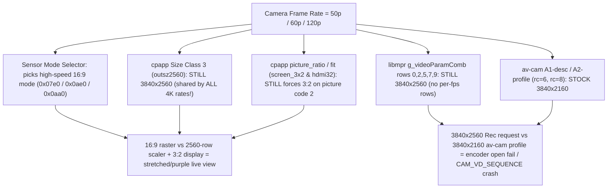

# Failsafe Fallback Architecture, Initialization Timing & 3:2 OSD Overlay Research

> [!IMPORTANT]
> **Clean-Room & Volatile RAM Notice:** This document records **100% offline** architectural analysis and Ghidra/Capstone verification against decrypted firmware targets outside this repository. Zero proprietary binaries, decryption keys, or non-commercial unpacker references are stored here. Every candidate mitigation targets **volatile RAM only** (`persistent_writes: false`; battery pull >= 10 seconds restores factory state), and all runtime verification must begin with read-only `CT6` inspection before any write design is authored.

**Target Platform:** Sony 12.1MP Full-Frame (`IMX510` + `CXD90057` BIONZ XR)  
**Audited Baselines:** `ILCE-7SM3` v5.01 (`a7s3_501`) · `ILME-FX3` v7.02 (`fx3_702`) · `ZV-E1` v2.02 (`zve1_202`)

---

## Executive Summary

| Research Track | Current Field Behavior | Root Cause Summary | Recommended Next Action |
|---|---|---|---|
| **1. `50p / 60p / 120p` Safe Fallback** | Blocked in policy; switching to `60p` distorts preview and crashes camera | `av-cam` rate isolation leaves `cpapp-b` `outsz2560` (Size Class 3), `screen_3x2`, and `libmpr` `g_videoParamComb` active for `50p/60p/120p` while `IMX510` drops back to `16:9` readout | Keep blocked in `safe_daily` until a coupled **Option C** rate-aware coprocessor + `libmpr` dispatch design is emulated and `CT6`-verified |
| **2. Stills -> Movie Init Glitch** | Purple / lower-black standby on Stills -> Movie (S3/ZV-E1); ZV-E1 v1 rebooted before `dmmwb_zv_v1` | (A) ZV-E1 DMM raw buffer `0x43e` (`10.3 MB` stock) fails `4288x2848` (`12.2 MB`) unless `L13` runs in Stills; (B) Stills -> Movie uses lightweight `0x86cb60` mode switch instead of `0x86cde6` `fullinit` | Enforce Gate 1 (`L13` in cold-boot Stills) + closing Movie `dump` / 1s Rec cycle; investigate `0x86cb60` vs `0x86cde6` / `0x335a94` pipeline flush |
| **3. 3:2 Preview AF / Tracking Overlay** | Focus frames work at `3:2` (`S16`), blank under FX3 De-Squeeze; ZV-E1 tracking box vertically stretched | `screen_3x2` / `lcdcycle` alter the `640x480` VDF video plane and check tables, while `cpActTrackingFrame` (`0x129288` ZV / `0x129608` S3) still branches on `640x360` (`0x280 x 0x168`) `16:9` OSD space | Verify `0x63b624`/`0x63b664` (`0xcac010`/`0xcabfd0` aspect table) and `0x129384` (`ZV`) / `0x129704` (`S3`) Y-remap in Ghidra + `CT6` read-only dump |

---

## 1. Safe Fallback Architecture for `50p` / `60p` / `120p` on `IMX510`

### 1.1 Hard Physical Readout Ceiling (`IMX510` @ `36 MHz`)

The `IMX510` sensor timing law in coprocessor RAM follows:

$$\text{fps} = \frac{36{,}000{,}000 \times P}{(H_{\max} \times P + E) \times V_{\max}}, \qquad 0 \le E < P \le 255,\quad V_{\max} \equiv 0 \pmod{4}$$

Exhaustive search over the full-height readout window (`4240x2832` active; stage `4288x2848`) confirms:
- **Column 1 (`mode 0x01`, `hmin=312, vmin=3140`):** theoretical ceiling **`36.747 Hz`** (`0` exact solutions for `48.000p`, `50.000p`, or `59.940p`).
- **Column 3 (`hmin=256, vmin=2982`):** theoretical ceiling **`47.158 Hz`** (`0` exact solutions for `48.000p`, `50.000p`, or `59.940p`).
- Therefore, **native `3840x2560` open gate at `48p / 50p / 60p / 100p / 120p` is physically impossible on `IMX510`**. High-frame-rate modes must revert cleanly to stock **`16:9` (`3840x2160`)** readout (`0x07e0` / `0x0ae0` / `0x0ae1` for `50p/60p`; `0x0aa0` for `100p/120p`).

### 1.2 Why `av-cam` Rate Isolation Alone Produces Mixed State, Purple Preview & Crashes

In the current modular packs (`ogfile2560_hs_s_*`, `og_xavcsi_*`), `av-cam.bin` descriptors (`A1-desc`) and profiles (`A2-profile`) are rate-isolated: only `coding_rate_code` `2` (`29.97p`), `3` (`25p`), and `5` (`23.98p`) are patched from `3840x2160` to `3840x2560`, while `coding_rate_code == 6` (`50p / 60p`) and `coding_rate_code == 8` (`100p / 120p`) remain untouched at stock `3840x2160`.

However, **rate isolation in `av-cam` alone does NOT isolate the rest of the pipeline**, creating a four-way split-brain state whenever the user selects `50p / 60p / 120p`:



1. **Coprocessor `outsz2560` is rate-agnostic:** Size-table setup (`0x40af34` on `a7s3_501`, `0x4008ec` on `fx3_702`, `0x4aadd8` on `zve1_202`) populates a single **Size Class 3** entry (`0x13ec2e4` S3, `0x13c31c8` FX3, `0x199655c` ZV) shared across **all** `3840x2160` frame rates (`23.98p` through `120p`). Switching to `60p` selects a `16:9` sensor mode (`0x07e0` / `0x0ae0` / `0x0ae1`), yet `outsz2560` still asks the second scaler and raw/output pipelines for `3840x2560`.
2. **`ogsq` timing & `MULTI_REC` boundary:** `ogsq_*_v2/v3` patches drive modes `0x8c0` (`23.98p`/`24p`) and `0x820` (`25p`/`29.97p`). `50p`/`60p`/`120p` route to distinct high-speed drive modes, so the sensor runs at `16:9` vertical height while the downstream scaler (`outsz2560`) expects `2560` rows—producing the stretched/purple live view and `CAM_VD_SEQUENCE` sync faults observed when testers switched to `60p`.
3. **`libmpr` `g_videoParamComb` is rate-agnostic:** Rows `0, 2, 5, 7` (Long-GOP AVC/HEVC) and `9` (XAVC S-I) are indexed by codec/resolution class without separate `24p/30p` vs `60p/120p` rows, and `L2-mp4-avc`/`L2-mp4-hevc`/`L3-nrt-vline` unconditionally emit `2560` (`0xa00`) for `3840`-wide 4K recordings.
4. **`screen_3x2` and `hdmi32` are rate-agnostic:** `lcdratio32_s3_v1`, `lcd32dsq_fx3_v1`, `lcdfill_zv_v2`, and `hdmi32_*` modify the `16:9` (`picture code 2`) ratio/fit constants globally, so even a clean `16:9` `50p/60p/120p` standby signal would render vertically stretched (`3:2` on a `4:3`/`3:2` panel) or pillarboxed on HDMI.

### 1.3 Concrete Fallback Design Options

| Option | Mechanism | Binary Scope | Pros | Cons / Blockers |
|---|---|---|---|---|
| **Option A: Policy & Pre-Switch Putback** *(Current)* | Keep `50p/60p/120p` blocked in docs/UI; user runs `putback` or pulls battery before HFR | None (host workflow) | Zero new hooks; zero regression risk on `23.98p/25p/29.97p` | Inconvenient on set; accidental dial/menu switch to `60p` still crashes |
| **Option B: Encoder-Only Refusal (`libmpr` / `av-cam`)** | Leave `av-cam` `rc=6/8` at `2160` and reject `Rec` in `libmpr` when `fps > 30` | `libmpr` / `av-cam` | Prevents corrupt `3840x2160`/`2560` files | **Insufficient:** standby live view still enters `outsz2560` + `16:9` sensor mode and crashes before Rec |
| **Option C: Dynamic Rate-Aware Dispatch** *(Recommended Engineering Target)* | Hook coprocessor size consumer & `picture_ratio` to branch on active drive mode (`0x8c0`/`0x820` -> `2560` & `3:2`; all other modes -> `2160` & `16:9`), paired with rate-aware `libmpr` `RecAttribute`/`g_videoParamComb`/`NRT` trampoline | `cpapp` RAM code cave + `libmpr` `PT_LOAD[0]` cave | Seamless **auto-revert to stock `16:9`** on `50p/60p/120p` (and `1080p` / `S35` modes!) without `putback` | Requires identifying a safe coprocessor hook point & verifying `libmpr` `MakeMovieInternal` caller state across all 3 models |
| **Option D: `appFw` Menu Interlock** | Intercept `50p/60p/120p` selection in `appFw` UI handler to block selection or notify user while open-gate is active | `appFw` `PT_LOAD[0]` cave (`.rela.dyn` / segment tail) | Prevents accidental user selection in menu | Does not protect against S&Q dial / custom memory recall (`MR 1/2/3`) unless all entry paths are hooked; `appFw` menu gates span `PT_LOAD[1]` + `.bss` PRM/HAITA |

### 1.4 Risk Matrix for Reverting cleanly to Stock `16:9`

| Risk Dimension | Option A (Putback) | Option B (Encoder Refusal) | Option C (Rate-Aware Coprocessor + `libmpr`) | Option D (`appFw` Menu Lockout) |
|---|---|---|---|---|
| **Standby Purple / Crash on `60p` Switch** | High if user forgets `putback` | High (unchanged) | **Low** (size class & display revert dynamically) | Medium (memory recall / S&Q dial bypass risk) |
| **Memory / Cave Footprint** | `0 B` | `< 64 B` | Medium (`~200–400 B` in `cpapp` + `~160 B` in `libmpr` `PT_LOAD[0]`) | Medium (`~150 B` in `appFw` `PT_LOAD[0]`) |
| **Cross-Pack Disjointness (`mp4_3x2`, `hdmi32`, `xavc_si`)** | N/A | High | Must integrate `L1-comb`, `L2-mp4`, `L3-nrt-vline`, and `hdmi32` branches cleanly | Orthogonal to `libmpr` / `cpapp` |
| **Regression Risk to `23.98p / 25p / 29.97p`** | None | Low | Medium (must verify `0x8c0`/`0x820` detection under both NTSC & PAL) | Low |
| **Reversibility via `putback` / Battery Pull** | 100% | 100% | 100% (volatile RAM only) | 100% (volatile RAM only) |

**Candidate Investigation Targets for Option C:**
1. **`cpapp` size-table consumers:** Trace RAM references to `0x13ec260`/`0x13ec2e4` (`a7s3_501`), `0x13c3144`/`0x13c31c8` (`fx3_702`), and `0x19964c4`/`0x199655c` (`zve1_202`) from size-setup callers (`0x40a8b8`/`0x40a8c6` S3, `0x400270`/`0x40027e` FX3, `0x4aa714`/`0x4aa722` ZV-E1) to find the single runtime size-lookup accessor where `Size Class 3` can return `3840x2560` iff `drive_mode in {0x8c0, 0x820, 0x28c0, 0x2820}` and `3840x2160` otherwise.
2. **`cpapp` display ratio (`picture_ratio`):** In `0x1e4f64` (S3), `0x1df794` (FX3), and `0x1f5e5c` (ZV-E1), gate the `9/16 -> 2/3` (`screen_3x2`) and `hdmi32` pillarbox return values on active open-gate state (`drive_mode` or runtime output height `== 2560`), restoring `9/16` (`16:9`) automatically in `50p/60p/120p` and non-open-gate modes.
3. **`libmpr` rate-conditional muxer:** In `FUN_00223c4c` (`L2-mp4`), `FUN_001181cc` (`L3-nrt-vline`), and the caller of `g_videoParamComb`, check the requested frame rate (`> 30 fps`) and return `2160` (`0x870`) + `b_aspectValid = 1` when `fps > 30` (using existing `PT_LOAD[0]` `.text` caves such as S3 `0x1e9db94` or ZV `0x1f576f8`, or segment tail).

---

## 2. Stills -> Movie Initialization Glitch Root Cause & Mitigations

Two distinct initialization hazards affect the `Stills -> Movie` boundary on `IMX510` bodies. Separating them explains why `ZV-E1 v1` crashed fatally while `a7S III v4/v5` and `ZV-E1 v2` exhibit a recoverable purple/lower-black standby picture.

### 2.1 Hazard A: DMM `rawbuf_size` (`0x43e`) Timing & `L13` Precondition (`ZV-E1 2.02`)

- **Root Cause:** In movie mode, the camera core allocates raw-frame write buffers from memory ID `0x43e` (`key 0x57f`, group `0x89` inside `28,311,552 B` parent `0x38`). On `a7S III` (`26,214,400 B`) and `FX3` (`27,864,320 B`), the stock unit easily fits the full-height first stage (`4288 x 2848 = 12,212,224 B`). On **`ZV-E1 2.02`**, stock unit `0x43e` is only **`10,325,504 B`** (exact `4288 x 2408`).
- **Failure Signature (`ZV-E1 v1`, 2026-11-23):** When `ogsq` runs without enlarging `0x43e` (`RAM 0x2580150`) first, port setup (`0x2613a8`) refuses the `2848`-row frame (`CamCore: AIF%d out[0x%x] > memsize[0x%x]`) and returns no error; the Dev stage stalls at its sync point for 11 frames (`0x19acf78 == 11`), logs `"FW: S-Ele Refresh ng force exception"`, and executes `str r0, [r0]` (`r0 = 0`) at `0x4b2d86` inside `CAM_VD_SEQUENCE` — rebooting the camera and wiping all volatile RAM patches.
- **Why `L13` Timing Is Strict:** `L13` (`dmmwb_zv_v1`) modifies the RAM copy of `DmmCfg.bin` (`0x2580150`, `0x9d8e00 -> 0x1900000`) **only if no unit object of `key 0x57f` is open in a DMM division**. Once the camera enters Movie mode even once after boot, `0x43e` allocations can remain live in the DMM division (`written_while_a_stock_buffer_is_open` leaves the active allocation at `10.3 MB` until freed), so `L13` refuses to write unless applied **first** after a cold-boot in **Stills** mode (enforced by Gate 1 and `L13` step order: `L13 -> L5 -> L16`).

### 2.2 Hazard B: Lightweight Stills -> Movie Mode Switch vs. `fullinit` / Cached Pipeline State

- **Symptom:** On `a7S III` (and `ZV-E1` intermittently), transitioning **Stills -> Movie** *after* applying `ogsq` produces a **purple live-view cast with the lower ~15–19% of the frame black**, matching the visual signature of a `16:9` (`2392`-row) sensor stream entering a `2832/2848`-row full-height pipeline.
- **Confirmed Evidence from Live `a7S III v4` Dumps (`PORT_NOTES.md`):**
  1. Dumps taken **during** the purple standby state and **after** a recording showed identical `ogsq` patch bytes, identical `313 x 4788 (P57, E34)` stored-record timing, identical `0xe011` (`col 1`) sensor registers, and identical second-scaler dimensions (`4240x2832 -> 3840x2560`).
  2. Exiting a USB dump session (`IMG INIT` in the `0xc0000` coprocessor bootlog) with the dial on Movie, or starting/stopping a 1-second recording, **immediately cures the purple standby**, and subsequent Stills <-> Movie switches can work until the next cold/Stills entry—or recur on every Stills -> Movie entry depending on power/stream state.
- **Root Cause (Offline Disassembly in `cpapp-b.bin`):**
  - Sensor sequence selection dispatches on drive-mode ID class (`0x86cb90`: `< 0xa000` live-view/movie; `0x86cbca`: `0xa002` capture; `0x86cbf6`: `0xe000` capture). Stock `0x8c0` (`< 0xa000`) uses `col 11` (`mode 0x21`, `16:9`), whereas `ogsq` assigns `col 1` (`mode 0x01`, `4240x2832` from `0xe011`) to a `< 0xa000` movie drive mode.
  - On a live **Stills -> Movie** switch, `cpapp` invokes lightweight mode-switch routines (`0x86cb60` / `0x86d608` / `0x335a94` on S3; `0x86cb60` pattern-matched across FX3/ZV-E1) rather than full sensor/DFE power-up initialization (`0x86cde6` `fullinit` -> `0x86ced6` / `0x332c04` / `0x333af4`), leaving stale Stills DFE/scaler/display pipeline state cached until `IMG INIT` or Record start forces `fullinit`.

### 2.3 Mitigations & Candidate Investigation Targets

**Current Mitigations (Implemented in Studio Workflow):**
1. **Cold-Boot Stills + `L13`-First Ordering:** Gate 1 enforces cold-boot Stills before any `apply` (`L13` runs first on `zve1_202`).
2. **Closing Movie-Mode `dump` (`IMG INIT` Trigger):** After writing patches in Stills, the operator switches to Movie mode before the closing read-only `dump`; exiting that USB session triggers `IMG INIT` directly in Movie mode.
3. **1-Second Record Toggle:** If purple standby appears after a Stills -> Movie transition on set, starting and stopping a 1s recording re-initializes the pipeline cleanly.

**Candidate Firmware Investigation Targets (Ghidra + `CT6` Read-Only):**

| Target | `a7S III 5.01` | `FX3 7.02` / `ZV-E1 2.02` | Investigation Hypothesis |
|---|---|---|---|
| **Lightweight switch vs `fullinit`** | `0x86cb60`, `0x86cde6`, `0x335a94` | Pattern-matched `0x86cb60` equivs in `fx3`/`zve1` | Trace callers of `0x86cb60` vs `0x86cde6` on Stills -> Movie transition to determine whether a 1-instruction branch or flag forces `fullinit` (`0x86cde6`) on `0x8c0`/`0x820` entry |
| **Drive-mode class guards** | `0x86cb90` (`< 0xa000`), `0x86cbca`, `0x86cbf6` | Equivalents in `cpapp` | Check if `< 0xa000` predicate skips a `0xe000`-class DFE/link/scaler reset (`dfeImagerPowerCtrl`, `0xf39f08` on S3) during live-view switch |
| **Mode-table `D+0x4` & geometry `+8`** | `0xc71b78` (`478 -> 484`) | `0xc54ce4` (FX3), `0xdcd9f8` (ZV) + ZV geometry `+8` (`418`) | Confirm whether `D+0x4` or ZV geometry `+8` controls standby vs record stream setup |
| **Fit / Camdev scaler commit** | `0x6e2204`, `0x6df7e4` | Equivalents in `cpapp` | Inspect whether cached scaler/display pipeline registers are only rewritten when `Record` or `IMG INIT` sets a dirty bit |

---

## 3. AF / Tracking-Overlay Geometry in `3:2` Preview & OSD Y-Remap Targets

### 3.1 Video Plane (`lcdcycle` / `screen_3x2`) vs. `16:9` OSD Coordinate Space

In OpenGate Studio, `screen_3x2` (`lcdratio32_s3_v1`, `lcd32dsq_fx3_v1`, `lcdfill_zv_v2`) and `lcdcycle` (`lcdcycle_s3_v3`, `lcdcycle_zv_v1`) operate inside a **`640 x 480` normalized VDF panel grid** (`cpapp-b.bin`):

| Body | Rear Panel | Fit Word (`16:9` pic) | `picture_ratio` (`16:9` case) | Patched Frame-Widget Table Rect `(x, y, w, h)` |
|---|---|---|---|---|
| **ZV-E1 `2.02`** | `3:2` (`720x480`, type `3`) | `0x1f5c88`: `3` (letterbox) -> `0` (fill) | *(uses fill; `lcdcycle` steps `0xe09f04f`..)* | `0xe9b420` (`AfWindow`), `0xe9b498` (`TrackingFrame`) row 1: `(0,38,640,404) -> (0,0,640,480)` |
| **a7S III `5.01`** | `4:3` (`800x600`, type `2`) | `0x1e4c78`: stays `3` (letterbox) | `0x1e4f98`/`0x1e4f9c`: `9/16 -> 2/3` | `0xd4d744`/`0xd4d7bc`/`0xd4d834` rows 0 & 2: `(0,60,640,360) -> (0,26,640,428)` |
| **FX3 `7.02`** | `4:3` (`800x600`, type `2`) | `0x1df4a8`: stays `3` (letterbox) | `0x1df7b8`/`0x1df7bc`: `9/16 -> 2/3` (+ `0x1df680` De-Squeeze) | `0xd2e510`/`0xd2e588`/`0xd2e600` rows 0/2 `(0,26,640,428)`, row 1 `(0,0,640,480)` |

Two distinct failure modes occur when drawing AF and subject-tracking overlays over the `3:2` or anamorphic de-squeezed live-view video plane:

1. **Hard Rectangle Validation Gate (`±5` Grid Units):**
   - `cpActAfWindow` (`0x128438` ZV, `0x128878` S3, `0x128708` FX3) and `cpActTrackingFrame` (`0x129468` ZV, `0x1297e8` S3, `0x129370` FX3) query the active VDF display rectangle (`0x6355da` / `0x635656` on ZV) and require every edge `(x, y, w, h)` to match the expected table entry within `±5.0` units (`vcmpe.f64 d1, #5.0`).
   - If the VDF video plane is letterboxed/de-squeezed without updating the table (e.g., FX3 native De-Squeeze Display at `0x1df680`), the check returns `0` and **suppresses focus/tracking boxes entirely** (confirmed in `lcd32dsq_fx3_v1` emulation).
2. **`640 x 360` (`16:9`) OSD Coordinate Space Y-Remap Mismatch (Stretched Tracking Box):**
   - Disassembly of `cpActTrackingFrame` coordinate transformation (`0x129288..0x129450` on `ZV-E1`, `0x129608..0x1297d0` on `a7S III`) shows a **two-stage projection**:
     - **Stage 1:** Projects sensor tracking coordinates into the `640 x 480` panel grid using VDF dimensions returned by `0x63b624` / `0x63b664` (ZV), which index `6`-entry aspect lookup tables at **`0xcac010`** (`widths = [640, 640, 640, 480, 640, 640]`) and **`0xcabfd0`** (`heights = [480, 427, 360, 480, 480, 338]`), then clamps `x` to `[0, 639]` and `y` to `[0, 479]`.
     - **Stage 2 (`0x129384` ZV / `0x129704` S3):** Explicitly checks:
       ```text
       cmp.w r1, #0x280   ; width == 640?
       bne   done
       cmp.w r0, #0x168   ; height == 360? (16:9 OSD coordinate space!)
       bne   done
       ```
       Only when Stage 1's OSD target dimensions equal **`640 x 360` (`16:9`, index `2` of `0xcac010`/`0xcabfd0`)** AND the raw VDF rect (`0x63b3da` ZV / `0x58c432` S3) differs from the displayed VDF rect (`0x63b448` ZV / `0x58c4a0` S3) does `cpActTrackingFrame` apply a vertical `(y, h)` rescale.
   - Because stock movie mode still tags the stream as **`16:9` (`index 2` -> `640 x 360`)** while `lcdfill_zv_v2` stretches the video plane (`fit = 0`) across all **`480` rows** (`720x480` `3:2` panel), the `640x360` OSD coordinate remap and the `640x480` video plane disagree vertically (`480 / 360` vs `480 / 404` / `32/27` squeeze), explaining the **vertically stretched / misaligned tracking box** reported in ZV-E1 field testing (2026-11-24).

### 3.2 Concrete OSD Y-Remap Research Targets

| Layer / Binary | Target / Symbol | `ZV-E1 2.02` | `a7S III 5.01` | `FX3 7.02` | Research Objective |
|---|---|---|---|---|---|
| `cpapp-b.bin` | `cpActTrackingFrame` coord transform | `0x129288` (`0x129384` `640x360` gate) | `0x129608` (`0x129704` `640x360` gate) | `0x129370` neighborhood | Trace exact `(y, h)` scaling at `0x129384..0x129444` (`ZV`) and `0x129704..0x1297c4` (`S3`); test whether clamping/un-squeezing `[0x63b3da]` vs `[0x63b448]` (`ZV`) aligns tracking boxes across `3:2`, `2:1`, `2.25:1`, `2.4:1` |
| `cpapp-b.bin` | VDF dimension tables & accessors | `0x63b624`, `0x63b664`, `0xcac010`, `0xcabfd0` | `0x58c432`, `0x58c4a0` (VDF rects) | `0x57b84e` neighborhood | Inspect `[r0 + 0x12d]` / `[r0 + 0x12f]` aspect index (`2` = `640x360` vs `0` = `640x480` / `1` = `640x427`) during `3:2` open-gate live view |
| `cpapp-b.bin` | `cpActAfWindow` coord transform & check | `0x128438`, `0x128530`, `0x128728` (`0x128814`) | `0x128878` (`0x12872c`) | `0x128708` | Compare `cpActAfWindow` (lacks `640x360` branch on `0x128728` ZV) against `cpActTrackingFrame` to verify why focus area boxes align differently from face/tracking boxes |
| `cpapp-b.bin` | `OsdMemInfoManager` / `FaceFrame` bounds | `0x1655bf..0x16c88c`, `0xf45941` | Equivalent `OsdTrans` strings | Equivalent `OsdTrans` strings | Check whether `OsdTransSetCpWidgetInfo` clips `FaceFrame` to the `16:9` letterbox rectangle (`"out of LetterBox"`) |
| `appFw.so` | `No529_FaceTrackingFrame`, `No923_FaceTrackingFrame`, `No5_FocusFrame`, `No8_FocusFrameUpperLeftPanel43` | Str `0x3b80692` (`refs 0x10bfff0`..), `0x3b917d4`, `0x3b8c5cf`, `0x3b8226f` | Str `0x405747c`, `0x4147d7a`, `0x414be3f`, `0x4035f88` | Str `0x310a5b0`, `0x31193a5`, `0x3115171`, `0x310babe` | Inspect whether `appFw.so` switches OSD widget layout using `Panel43` vs `16:9` coordinate anchors (`FocusFrameInfo` enums) when `lcdcycle` updates VDF layout |

### 3.3 Recommended Next Verification Steps (Read-Only First)

1. **Offline Ghidra Decompilation (`sony_12mp_opengate.gpr`):** Decompile `ZV 0x129288` (`cpActTrackingFrame`), `0x63b624`/`0x63b664`, `0x63b3da`/`0x63b448`, and `S3 0x129608` (`cpActTrackingFrame`) + `0x128438`/`0x128878` (`cpActAfWindow`) to verify the exact input/output coordinate units of `(fp, r4, sb, r6)` and `[sp, #0x18]` vs `[sp, #8]`.
2. **Read-Only `CT6` Dump Check:** Read `[r0 + 0x12d]` / `[r0 + 0x12f]` and VDF layout structs in Movie mode (`3:2` stock vs `lcdfill_zv_v2` vs `lcdcycle` `2.4:1`) on `ZV-E1` and `a7S III` before crafting any volatile OSD Y-remap patch.
3. **Controlled Framing-Chart Field Verification:** Capture rear-LCD photographs of a face/tracking target at top, center, and bottom fifths of the `3:2` frame under `lcdfill_zv_v2` / `lcdratio32_s3_v1` to measure exact vertical tracking-box offset in pixels before/after any future `cpActTrackingFrame` patch.

---

## 4. Cross-Body Offline Verification Findings (2026-11-27)

Static offline disassembly across unpacked `cpapp-b.bin` (`CPAPP_BASE = 0x108000`) and `libmpr.so` (`a7s3_501`) confirms the following cross-body entry points, guard predicates, and register contracts. All addresses below remain read-only research findings pending live read-only `CT6` validation.

### 4.1 OSD & Tracking Frame (`cpActTrackingFrame` & Aspect Tables)

| Component | `ZV-E1` | `a7S III` | `FX3` | Verified Behavior |
| :--- | :--- | :--- | :--- | :--- |
| `cpActTrackingFrame` | `0x129288` | `0x129608` | `0x129200` / `0x129370` | `ZV-E1` and `a7S III` share a two-stage OSD normalization pipeline; `FX3` normalizes directly via `0x57b84e` / `0x57fb54` / `0x57fbc2` without a `640x360` Stage 2 branch |
| Stage 1 OSD dim lookup | `0x63b624`, `0x63b664` | `0x58c67c`, `0x58c6bc` | — | Reads signed byte `[r0 + 0x12d]` / `[r0 + 0x12f]` clamped at index `5` |
| 6-entry OSD height/width tables | `0xcabfd0` / `0xcac010` | `0xb4fc80` / `0x298824` | `0xb365f0` / `0x2938e4` | Height table `[480, 427, 360, 480, 480, 338]`; width table `[640, 640, 640, 480, 640, 640]` on `ZV-E1` / `a7S III` (`FX3` width check differs) |
| Stage 2 `640x360` (`0x280 x 0x168`) Y-remap gate | `0x129384` (`0x63b3da` raw, `0x63b448` disp) | `0x129704` (`0x58c432` raw, `0x58c4a0` disp) | None | Branches on `cmp.w r1, #0x280; bne; cmp.w r0, #0x168; bne` before remapping vertical coordinates |

### 4.2 Stills-to-Movie `fullinit` Gate & Cache Check (`[r4, #0x1c]` / `[r4, #0x2c] == 7`)

| Component | `a7S III` | `FX3` | `ZV-E1` | Verified Behavior |
| :--- | :--- | :--- | :--- | :--- |
| `fullinit` | `0x86cde6` | `0x85750c` | `0x96d21c` | Writes `7` to `[r4, #0x1c]` and `[r4, #0x2c]` upon completion |
| Mode-switch dispatcher | `0x335a94` (gate `0x335ac2`) | `0x330d70` region (gate `0x330d9e`, calls `0x85750c` at `0x330db2`) | `0x390994` region (gate `0x3909c2`, calls `0x96d21c` at `0x3909d6`) | Checks dual state flags (`[r4, #0x530] == 1 && [r4, #0x534] == 1` on `a7S III`/`FX3`; `[r4, #0x534] == 1 && [r4, #0x538] == 1` on `ZV-E1`) |
| Init guard wrapper | `0x332624` (cmp `0x33263e`) | `0x32d900` (cmp `0x32d91a`) | `0x38d4b4` (cmp `0x38d4ce`) | `cmp r1, #7; it eq; cmpeq r2, #7; beq` — skips `fullinit` when both cached state fields already equal `7` from Stills mode |

### 4.3 `50p`/`60p`/`120p` Option C Register Contracts (`picture_ratio` & `libmpr.so`)

1. **`cpapp-b.bin` `picture_ratio` (`0x1e4f64` `a7S III`, `0x1df794` `FX3`, `0x1f5e5c` `ZV-E1`):** Receives packed `(height << 16) | width` in `r1`, unpacking height via `lsrs r3, r1, #0x10` and width via `uxth r2, r1` (`RECT` output `{x, y, w, h}`). Note `a7S III` / `ZV-E1` accept 3 stack arguments (`fit`, `flag`, `out_rect`, with `flag & 1` selecting `100:235`), whereas `FX3` accepts 2 stack arguments (`fit`, `out_rect`) without the `100:235` branch.
2. **`libmpr.so` (`a7s3_501`) HFR Frame-Rate Selectors:**
   - `L2-mp4` (`0x223c4c` `a7s3_501`, `0x21fec4` `fx3_702`, `0x207d14` `zve1_202`): loads the **bitrate index** (`2..53`) from `[x1, #0x14]` and loads the **true frame-rate enum** (`0..11`: `0=23.98p, 1=24p, 2=25p, 3=29.97p, 4/5=50p, 6/7=59.94p, 8=100p, 9=119.88p, 10=200p, 11=239.76p`, Q16 table at `0x2dc848` `a7s3_501` / `0x2ba208` `zve1_202`) from **`[x1, #0x18]`**.
   - `L3-nrt-vline` (`0x1185f0` `a7s3_501`): loads the HFR sensor frame-rate scalar from `[x20, #0x138]` at `0x118684`.
   - `NrtMetaWrapper::Init` (`0x253f64` `a7s3_501`, `0x2500d0` `fx3_702`, `0x237f5c` `zve1_202`): copies `RecAttribute.height` (`[x20, #0x5e]`) to `[x29, #0x74]` and unconditionally sets `b_aspectValid = 1` into `[x29, #0x78]`.

---

## 5. Unicorn Emulation & Candidate Volatile-RAM Prototypes

All Track 3A, 3B, and 3C candidate volatile-RAM patches below were verified **100% offline** in Unicorn (`ARM Thumb-2 + VFP` with `CPACR = 0x00F00000`, `FPEXC = 0x40000000` for `cpapp-b.bin`, and `AArch64` for `libmpr.so`) against unpacked `zve1_202`, `a7s3_501`, and `fx3_702` targets. Every trampoline fits inside a zero-filled `.text` tail cave verified unused in each image.

### 5.1 Read-Only `CT6` Inspection Targets (Verify Before Any Write)

| Subsystem / Check Target | `zve1_202` (`ZV-E1 2.02`) | `a7s3_501` (`a7S III 5.01`) | `fx3_702` (`FX3 7.02`) | Expected Stock State / Note |
| :--- | :--- | :--- | :--- | :--- |
| Active drive mode (`u16` global) | `0x11d70d0` | `0x1032940` | `0x100d740` | Open-gate low-bit13: `0x8c0`/`0x820`; HFR: `0xae0`/`0x7e0`/`0xaa0` |
| Sensor/MIPI `r4_outer` singleton ptr | `0x17f1f64` -> `0x17f21f4` | `0x12a41f0` -> `0x12a4678` | `0x127ab68` -> `0x127aff0` | Vtable ref `0xdcc3e4+8` / `0xc7050c+8` / `0xc53678+8` |
| Sensor/MIPI `r4_inner` (`r4` in `start`) | `0x17f26e0` (`+0x4ec`) | `0x12a4b60` (`+0x4e8`) | `0x127b4d8` (`+0x4e8`) | Sub-object passed as `r4` to `CetusSlvsecDriver::start` |
| Cached lane / PHY `[r4_inner, #0x1c]` | `0x17f26fc` | `0x12a4b7c` | `0x127b4f4` | `7` after Stills init (`fullinit` skipped if `[r4,#0x2c]==7`) |
| Cached lane / PHY `[r4_inner, #0x2c]` | `0x17f270c` | `0x12a4b8c` | `0x127b504` | `7` after Stills init (`P2[1]`) |
| Queued `new_drv` (`[r4_inner, #0x48]`) | `0x17f2728` (`[r4_outer,#0x534]`) | `0x12a4ba8` (`[r4_outer,#0x530]`) | `0x127b520` (`[r4_outer,#0x530]`) | `drv_mode` pending during `start` (`#0x530..#0x548` block) |
| `Size Class 3` packed `(h<<16)\|w` | `0x199655c` | `0x13ec2e4` | `0x13c31c8` | Stock `0x08700f00` (`3840x2160`); Option C reads conditionally |
| `cpapp-b.bin` `.text`-tail zero cave | `0xc0fc98` (3A) / `0xc0fd20` (3B) / `0xc0fd80` (3C) | `0xae2f5c` (3A) / `0xae3000` (3B) / `0xae3200` (3C) | `0xaca944` (3A) / `0xacaa00` (3B) / `0xacac00` (3C) | All-zero bytes at end of `.text` |
| `libmpr.so` `PT_LOAD[0]` zero-tail cave | `0x2c7ee4` (284 B free) | `0x2eafa4` (92 B free) | `0x2e192c` (1748 B free) | Coupled 3C AArch64 trampolines use `48 B` (`32 B + 16 B`) |

### 5.2 Track 3A: `cpActTrackingFrame` Vertical Tracking-Box Un-Stretch (`ZV-E1` & `a7S III`)

Disassembly of `cpActTrackingFrame` (`0x129288` `zve1_202`, `0x129608` `a7s3_501`) and `VDF` getters (`0x63b3da`/`0x63b448` `zve1_202`, `0x58c432`/`0x58c4a0` `a7s3_501`) confirms Stage 1 scales vertical coordinates from the `640x360` tracking grid only when `raw_vdf.h == 360`, and Stage 2 gates `y_center`/`h` scaling via `0x129384` (`zve1_202`) / `0x129704` (`a7s3_501`):

- **Un-stretch candidate trampoline:**
  - **`zve1_202` (`0x1293bc -> 0xc0fc98`, `720x480` panel, PAR `9:8`):** Hooks the Stage-2 height store when `raw_vdf.h == 360` and `disp_vdf.h == 480` (`lcdfill_zv_v2` active). Replaces the stretched height `h_s` with `h_new = (orig_h * 9 + 4) >> 3` (matching `720x480` panel pixel aspect so a `64x64` sensor-grid square renders `72x72` physical px) and recenters `y_new = y_s + ((h_s - h_new) >> 1)`.
  - **`a7s3_501` (`0x1297c0 -> 0xae2f5c`, `800x600` panel, PAR `1:1`):** Hooks `vstr s0, [sb]` when `disp_vdf.h == 428` (`0x1ac`, `lcdratio32_s3_v1` active) and restores `h_new = orig_h`, `y_new = y_s + ((h_s - h_new) >> 1)`.

Unicorn VFP emulation results (`64x36` box at `10%` / `50%` / `90%` sensor Y, plus `64x64` 1:1 square at `50%`):

| Model (Panel / PAR) | Input Box (`640x360` grid) | Stock `16:9` `(y, h)` | Unpatched 3:2 `(y, h)` | Patched 3:2 `(y, h)` | Aspect Verification |
| :--- | :--- | :--- | :--- | :--- | :--- |
| **`zve1_202`** (`720x480`, `9:8`) | `10%` (`y=18, h=36`) | `(58, 40)` | `(24, 48)` | **`(27, 41)`** | Matches `9:8` stock height (`40`/`41`) |
| **`zve1_202`** (`720x480`, `9:8`) | `50%` (`y=162, h=36`) | `(219, 40)` | `(216, 48)` | **`(219, 41)`** | Centered across `480px` panel |
| **`zve1_202`** (`720x480`, `9:8`) | `90%` (`y=306, h=36`) | `(381, 40)` | `(408, 48)` | **`(411, 41)`** | Eliminates `4/3` (`+20%`) stretch |
| **`zve1_202`** (`720x480`, `9:8`) | `50%` `64x64` square | — | `(w=64, y=197, h=85)` (`1.18x`) | **`(w=64, y=203, h=72)`** | `64*(720/640)=72px` wide by `72px` tall (`1:1`) |
| **`a7s3_501`** (`800x600`, `1:1`) | `10%` (`y=18, h=36`) | `(78, 36)` | `(47, 42)` | **`(50, 36)`** | Eliminates `428/360` (`+18.9%`) stretch |
| **`a7s3_501`** (`800x600`, `1:1`) | `50%` (`y=162, h=36`) | `(222, 36)` | `(218, 42)` | **`(221, 36)`** | Centered inside `428px` active 3:2 frame |
| **`a7s3_501`** (`800x600`, `1:1`) | `90%` (`y=306, h=36`) | `(366, 36)` | `(389, 42)` | **`(392, 36)`** | Symmetrical near bottom of 3:2 frame |
| **`a7s3_501`** (`800x600`, `1:1`) | `50%` `64x64` square | — | `(w=64, y=201, h=76)` (`1.19x`) | **`(w=64, y=207, h=64)`** | `64*(800/640)=80px` wide by `80px` tall (`1:1`) |

Stock-mode regression checks (`disp = (0, 38, 640, 404)` on `zve1_202` and `(0, 60, 640, 360)` on `a7s3_501`) pass identically without entering the 3:2 un-stretch branch.

### 5.3 Track 3B: Stills-to-Movie `fullinit` Cache Guard

Trace of the mode-switch dispatcher (`0x335a94` `a7s3_501`, `0x330d70` `fx3_702`, `0x390994` `zve1_202`) and call site (`0x335e74` / `0x331150` / `0x390d70`) shows `CetusSlvsecDriver::start` (`0x332624` / `0x32d900` / `0x38d4b4`) is invoked directly without a preceding `fullinit` flush. Because `P1[1]` and `P2[1]` cached inside `[r4, #0x1c]` and `[r4, #0x2c]` are both `7` after Stills mode, stock skips `fullinit` (`cmp r1, #7; it eq; cmpeq r2, #7; beq skip`).

- **Candidate volatile-RAM guard (`0x33263e -> 0xae3000` `a7s3_501`, `0x32d91a -> 0xacaa00` `fx3_702`, `0x38d4ce -> 0xc0fd20` `zve1_202`):**
  Reads `ubfx r0, [r4, #0x48], #0, #13` (`new_drv & 0x1fff`) and forces the `fullinit` branch whenever the low 13 bits match `0x8c0` (23.98p / 24p) or `0x820` (25p / 29.97p), falling back to stock `(r1 == 7 && r2 == 7)` cache-skip behavior for all Stills and non-open-gate transitions.
- **Unicorn results (identical across `a7s3_501`, `fx3_702`, `zve1_202`):**
  - Stock `0x8c0` with cached `(7, 7)`: `fullinit_calls = 0` (reproduces Stills->Movie black/half-frame glitch).
  - Patched `0x8c0` (`23.98p`), `0x820` (`29.97p`), `0x28c0` (`24.00p` / PAL mask): `fullinit_calls = 1` even when cached `(7, 7)`.
  - Patched Stills `0xe011` / `0xa002` with cached `(7, 7)`: `fullinit_calls = 0` (cached Stills transitions unaltered); cold `(0, 0)` Stills `0xe011`: `fullinit_calls = 1`.

### 5.4 Track 3C: Coupled AArch32 + AArch64 Option C Frame-Rate Auto-Fallback (`23.98p-29.97p -> 3:2`, `50p-120p -> 16:9`)

Rather than writing static `0x0a000f00` (`3840x2560`) and unconditional `b_aspectValid = 0` across all rates, the candidate Option C design hooks both CPUs in volatile RAM:

1. **`cpapp-b.bin` (AArch32 Thumb-2):**
   - `Size Class 3` consumer (`0x42685c -> 0xae3200` `a7s3_501`, `0x41c214 -> 0xacac00` `fx3_702`, `0x4c7b28 -> 0xc0fd80` `zve1_202`): reads `drv_mode & 0x1fff` and returns `0x0a000f00` (`3840x2560`) iff `mode in {0x8c0, 0x820}`, else `0x08700f00` (`3840x2160`).
   - `picture_ratio` (`0x1e4f96` `a7s3_501`, `0x1df7b8` `fx3_702`, `0x1f5e8e` `zve1_202`): returns `2:3` (`lr=2, r0=3` -> `640x428` letterbox) iff `drv_mode & 0x1fff in {0x8c0, 0x820}`, else stock `9:16` (`lr=9, r0=16` -> `640x360`).
2. **`libmpr.so` (AArch64 leaf-safe `b` / `b` trampolines — preserves caller `x30`/`LR`!):**
   - `L2-mp4` (`strh w6, [x0, #0x40]` at `0x223d40` `a7s3_501`, `0x21ff9c` `fx3_702`, `0x207e08` `zve1_202` -> 32-byte cave): promotes `w6 == 0x870` to `0xa00` iff `ldr w9, [x1, #0x18]` (`fps_code`) is `<= 3` (`23.98p..29.97p`), leaving `50p..120p` (`fps_code >= 4`) at `0x870` (`2160`).
   - `NrtMetaWrapper::Init` (`mov w0, #1` at `0x25411c` `a7s3_501`, `0x250288` `fx3_702`, `0x238114` `zve1_202` -> 16-byte cave): reads `w9 = [x29, #0x74]` (`nrt_vline`) and outputs `b_aspectValid = (w9 != 0xa00) ? 1 : 0`, so `2560`-line clips clear `b_aspectValid` while `2160`-line HFR clips preserve stock `16:9` aspect signaling.

Coupled Unicorn emulation results across all 8 rates (`zve1_202`, `a7s3_501`, `fx3_702` identical):

| Rate | `fps_code` | `drv_mode` | `cpapp` Size Class 3 | `picture_ratio` (`640x480` LCD) | `libmpr` `L2-mp4` | `NrtMetaWrapper` `nrt_vline` | `b_aspectValid` |
| :--- | :--- | :--- | :--- | :--- | :--- | :--- | :--- |
| `23.98p` | `0` | `0x08c0` | `3840x2560` | `(0, 26, 640, 428)` (`3:2`) | `3840x2560` | `2560` | `0` (`3:2` square px) |
| `24.00p` | `1` | `0x28c0` | `3840x2560` | `(0, 26, 640, 428)` (`3:2`) | `3840x2560` | `2560` | `0` |
| `25.00p` | `2` | `0x2820` | `3840x2560` | `(0, 26, 640, 428)` (`3:2`) | `3840x2560` | `2560` | `0` |
| `29.97p` | `3` | `0x0820` | `3840x2560` | `(0, 26, 640, 428)` (`3:2`) | `3840x2560` | `2560` | `0` |
| `50.00p` | `4` | `0x27e0` | `3840x2160` | `(0, 60, 640, 360)` (`16:9`) | `3840x2160` | `2160` | `1` (`16:9` fallback) |
| `59.94p` | `6` | `0x0ae0` | `3840x2160` | `(0, 60, 640, 360)` (`16:9`) | `3840x2160` | `2160` | `1` |
| `100.0p` | `8` | `0x2aa0` | `3840x2160` | `(0, 60, 640, 360)` (`16:9`) | `3840x2160` | `2160` | `1` |
| `120.0p` | `9` | `0x0aa0` | `3840x2160` | `(0, 60, 640, 360)` (`16:9`) | `3840x2160` | `2160` | `1` |


