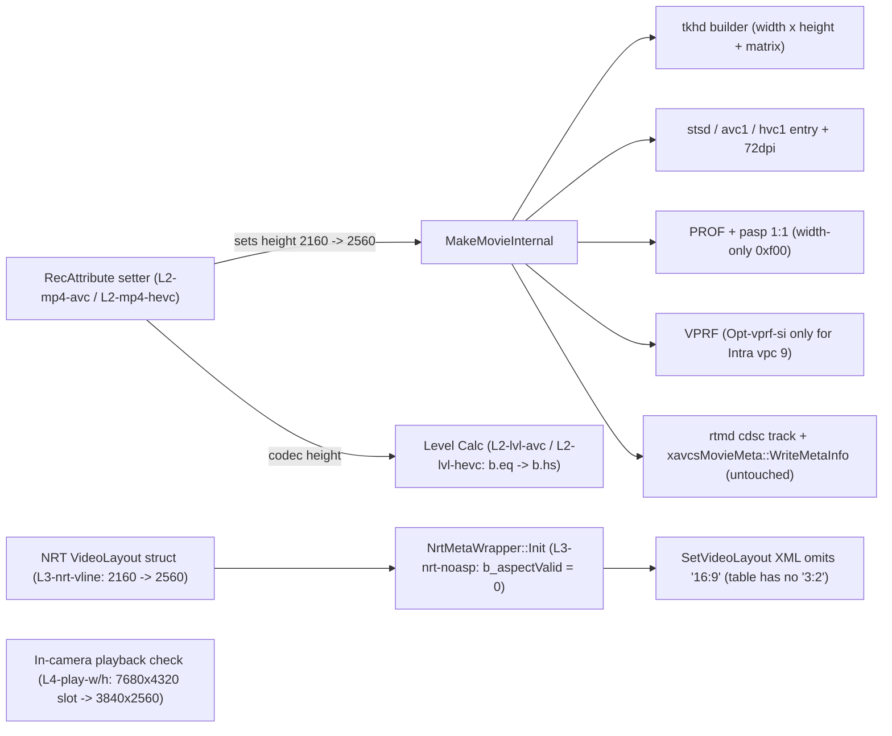

# Sony BIONZ XR 12.1MP Open-Gate Offset Audit & MP4 3:2 Muxer Roadmap

**Target Platform:** Sony 12.1MP Full-Frame (`IMX510` + `CXD90057` BIONZ XR)  
**Audited Baselines:** `ILCE-7SM3` v5.01 (`a7s3_501`) · `ILME-FX3` v7.02 (`fx3_702`) · `ZV-E1` v2.02 (`zve1_202`)  
**Reference Baseline:** `ILCE-7M4` v6.02 (`a7iv_602`, 33MP `IMX710`)

> [!CAUTION]
> **Hard Safety Guardrails:**
> 1. **100% Offline Unpacking Only:** Never flash `nflasha*`, `boot0`/`boot1`, or persistent `BK4` (`BACKUP.BIN`) settings containers.
> 2. **Volatile RAM Only:** Every camera-side patch targets volatile coprocessor RAM, `/dev/mem` (`av-cam.bin` @ `0x401000000`), or `/proc/self/mem` (`libmpr.so` / `appFw.so`) via `/tmp/jiritsu/libJit.so`. A cold boot (battery out for ≥10s) restores 100% stock state.
> 3. **Read-Only Gate First:** Never run a write step before `CT6_memory_read_check` (`check` + `dump`) returns `VERDICT READY` on the exact firmware version. Always pause for explicit user approval before any `sudo` or live USB command.

---

## 1. Multi-Binary Architecture & Ghidra Import Settings

A critical finding from auditing `a7iv-open-gate-test`, `a7siii-open-gate-test`, `fx3-open-gate-test`, and `zve1-open-gate-test` is that Open-Gate spans **four binaries across three partitions**—not just `appFw.so`:

| Partition | FS Type | Extracted Binary | CPU / Ghidra Language ID | Ghidra Load Base Address | Role in Open-Gate & MP4 3:2 |
|---|---|---|---|---|---|
| `nflasha8` (`/cp`) | FAT12/16 | `cpapp-b.bin` | `ARM:LE:32:v7` (ARM32/Thumb-2) | **`0x00108000`** | Sensor drive tables (`ogsq`), 3000B picture records, movie size table (`outsz2560`), rear-screen/EVF fit & de-squeeze (`lcdfill`/`lcdratio32`/`lcd32dsq`) |
| `nflasha8` (`/cp`) | FAT12/16 | `DmmCfg.bin` | Raw data table (in `cpapp` RAM) | Copied to RAM (`0x2580150` on ZV-E1) | Raw-frame write buffer unit `0x57f` (`id 0x43e`) enlarged on ZV-E1 (`dmmwb_zv_v1`) |
| `nflasha3` (`/system`) | FAT12/16 | `av-cam.bin` | `AARCH64:LE:64:v8A` | **`0xffffffc001000000`** (phys `0x401000000`) | Hardware codec/encoder tables: `A0-unit` memory class, `A1-desc` (29 rows), `A2-profile` (70 sites), `A3-clip` format row |
| `nflasha15` (`/usr`) | `ext4` | `lib/libmpr.so` | `AARCH64:LE:64:v8A` (ELF `.so`) | **`0x00000000`** (PIE file offset = VA) | **Media Player/Recorder & XAVC MP4 Muxer:** `g_videoParamComb` (`L1-comb`) **AND** the `L2-mp4` track-height (`2160` -> `2560`) & profile-compatibility logic! |
| `nflasha15` (`/usr`) | `ext4` | `lib/appFw.so` | `AARCH64:LE:64:v8A` (ELF `.so`) | **`0x00000000`** (PIE file offset = VA) | Main UI/application: C3/C2 preview-aspect cycle hook (`lcdcycle`), menu/aspect BKIDs (`movie_rec_aspect_xavc`) |

`./tools/unpack_firmware.sh` automatically extracts **all four partitions** (`nflasha15`, `nflasha7`, `nflasha8`, `nflasha3`) offline and stages symlinks in `firmwares/<model>/ghidra_targets/`.

> [!IMPORTANT]
> When importing raw `.bin` files (`cpapp-b.bin` or `av-cam.bin`) into Ghidra, click **Options...** in the Import dialog and set **Base Address** (`0x108000` for `cpapp-b.bin`; `0xffffffc001000000` for `av-cam.bin`) so all internal pointers and design offsets line up 1:1. For `libmpr.so` and `appFw.so`, set ELF Image Base to `0x0` so Ghidra VAs match JSON `file_off`/`va` values directly.

---

## 2. Firmware Version & SHA-256 Identity Pins

Both offline firmware audit tools (`unpack_firmware.sh` and `verify_all_offsets.py`, 100% offline), plus `CT6_memory_read_check` (on-camera read-only `check`), verify these exact SHA-256 digests and `version.txt` strings before permitting any operation:

| Artifact | a7S III `5.01` (`a7s3_501`) | FX3 `7.02` (`fx3_702`) | ZV-E1 `2.02` (`zve1_202`) |
|---|---|---|---|
| `BODYDATA.DAT` | `dbdd8b02ed81d6f0e0a0d36b55f5d12fa1bcf8682fbad1393996f10d1494c9eb` | `f040affe234a8b6ec996ba616108c0014573f3cf28deb8b442fd0be091cac854` | `a8775ce13a66881b93374f06d5f66331c0179c4c71a165dc894641bfdc4d2f05` |
| `version.txt` | `39183_16.2026041504` | `39180_21.2025122503` | `32000_08.2025101101` |
| `cpapp-b.bin` | `63122fceaeed8934258dba414bb215e4fc48631860eb6537e1b0c84cbe5d6843` | `c90d00d807874a5309dc1b65b203287e83608ceee513cc57b53409333fb6bcba` | `8e1ee4c48ee1c94c9edd6fe71f6633b7ba689d71ca4998feb1a421bf7b49de2a` |
| `DmmCfg.bin` | `b459f90693c2d7636968f75a1702498ac7ea54376ab0165a41e42ecebe2c83d7` | `820dc02b6a001636b93fff51d90baaced1ba75cf9bbaa90600dfc7fd7a705166` | `602f44a9f5675c9706ce5ea8998541e4d761e35bdf8d79b661c5e7ba75ff3792` |
| `av-cam.bin` | `27b7ab03f0b7a3ad93329e19a9d6c873cc3b22253edc7b18b2821dca3675666b` | `0cb7e03a59b4ec3d7633664ab0f7a9477892d1aaf442b9db83a7e9a62a49bdaf` | `36b49addab28db7010966b2ac2b89b75a0c99e8a8fa0e33c331f2733d15eb455` |
| `libmpr.so` | `59ea134f5a40166379258126b7ff02c0b36b9846129b22b4cdc7faa52c927459` | `9aeef3b9edb3d011c0c90cd2387b3a47bd3b506ebfa57be39ad1a9729771b57c` | `e45dde41291cf45dd80897e0d9fa03818c1cdc14ae4d466c64f3d48af419e7cd` |
| `libsencore.so` | `80b0e79f10ef0d26474e323b1621681a411ef083e7cf99547b3ec71227f77e94` | `a2907111c4a22314dcb12c25889e0e3142764c6a4a910a746e43908f76e7c410` | `784e5159c2f4d3c7a108e5c53a3673e037c686e7e5a199d986eadedbb1492f58` |
| `libJiritsu.so` | `cfc134190fd83bee36fe159e4fa90a65fe5ae04a803f921dce50d534ed0e1fd0` | `bdef58b24a3b67b4d14d4f0214b89aae0fcad19f114b4188c328f9d2c092f1d9` | `b260595f78f6b7f791bb69f2973badd85bf530cc198bf15648c8031172bc82f2` |
| `appFw.so` | `eba89299273542e9de89d64f3bd380114b2b9df67a246a6927cd7a83f2043781` | `545c5053a74e04ffbf2bbaaf80f558092dd545ed2298b2395ca547dbba58290f` *(unneeded; FX3 uses native De-Squeeze)* | `88146fa5f5844b45de9f20ab5f1750aa6e821e10658af37f88ce7d4d76a833f8` |
| `cpapp` 4KB ID Pages | `0x128000`, `0x4a8000`, `0x86d000`, `0xb11000` | `0x128000`, `0x4a8000`, `0x857000`, `0xaeb000` | `0x128000`, `0x4aa000`, `0x96d000`, `0x788000` |
| Offline Binary Audit | **678 static checks verified (0 mismatches)** via `verify_all_offsets.py` | **678 static checks verified (0 mismatches)** via `verify_all_offsets.py` | **678 static checks verified (0 mismatches)** via `verify_all_offsets.py` |
| Hardware Validation Status | **`23.98p` confirmed on camera** (`ogsq_s3_v5` + `lcdratio32_s3_v1` + `lcdcycle_s3_v2`, 2026-11-23); dual NTSC/PAL `ogsq_s3_v6` + `29.97p` Long-GOP & `XAVC S-I` **Unicorn-verified** | **`23.98p`, PAL `25p` (`0x820`), and `4:3` panel confirmed on hardware**; unified `ogsq_fx3_v2` + `29.97p` Long-GOP & `XAVC S-I` **Unicorn-verified** | **`23.98p` `v2` + SteadyShot Active/Dynamic Active confirmed on camera**; dual NTSC/PAL `ogsq_zv_v3` + `29.97p` Long-GOP & `XAVC S-I` **Unicorn-verified** |

---

## 3. Architectural Differences: 33MP a7 IV (`IMX710`) vs. 12.1MP (`IMX510`)

| Pipeline Stage | a7 IV 6.02 (`IMX710`, 33MP) | a7S III 5.01 / FX3 7.02 / ZV-E1 2.02 (`IMX510`, 12.1MP) |
|---|---|---|
| **Active 4K `23.98p / 25p / 29.97p` Modes** | `0x8c0` (index 10): `7008×3942` cropped from `7008×4672` | `0x8c0` (index 12, NTSC `23.98p`/`29.97p`) + `0x820` (index 10, PAL `25p`): `4240×2392` (row 220) cropped from **`4240×2832`** (stage `4288×2848`), patched via `MULTI_REC` |
| **Sensor Mode Switch** | 4K and full-height share timing registers; patch simply switches register column | No stock "4K timing + full-height" column exists. Patch switches `0x8c0` from column `11` (mode `0x21`, 16:9 band) to **column `1` (mode `0x01`, full-height from `0xe011`)** without altering the shared register matrix (preserving other 4K modes) |
| **MIPI Link Bit-Depth** | Unchanged 10-bit link | Stock `0x8c0` uses a **10-bit** link (`5,3` on A7S III/FX3; `6,3` on ZV-E1), whereas full-height `0xe011` is **12-bit (`0,2`)**. Both 3000B picture records must update 6 link-format words (`+0x274`, `+0x27c`, `+0x280`, `+0x284`, `+0x294`, `+0x2a8`) to 12-bit values (fixed tonal stepping in `ogsq_s3_v5`) |
| **Fractional Line Timing** | Stock timing kept | Decoded timing law: frame = $(HMAX + E/P) \times VMAX$ ticks @ $36\text{ MHz}$, requiring **`E < P`**, odd `P | VMAX`, `4 | VMAX`. Patched 59.94Hz row: **`313 × 4788, P 57, E 34`** (`23.976 fps`); 50Hz row: **`313 × 4780, P 239, E 193`** (`24.000 fps`) |
| **Vertical Squeeze Ratio** | `27/32` (`4672 × 27/32 = 3942.0`) | **`16/19`** (`2832 × 16/19 = 2384.8`, matching stock 2385-row second-scaler fit with zero cropped rows) |
| **Raw Write Buffer (`0x43e`)** | Needs `dmmwb4688_v1` (enlarges 26.8 MB -> 33.0 MB) | **a7S III** (`26,214,400` B) & **FX3** (`27,864,320` B) fit `4288×2848` (`12,212,224` B) natively. **ZV-E1** (`10,325,504` B = exact `4288×2408`) **requires `dmmwb_zv_v1`** (`0x2580150` -> `26,214,400` B) |
| **Rear LCD Panel Geometry** | The local kit uses a 3:2 rear panel, `lcdfill_v2` and the C3 preview cycle. | Hardware checks confirmed **4:3 (`panel-type = 2`)** on both `a7S III` and `FX3`. `ZV-E1` uses a 3:2 rear panel and the C2 preview cycle. [FX3 kit notes](https://github.com/ArcaneLantern/fx3-open-gate-test) |
| **Known Runtime Caveats** | A cold boot clears the kit. The maintainer reports that a power-off can also clear it. [a7 IV field kit](https://github.com/ArcaneLantern/a7iv-open-gate-test) | `23.98p` across all 3 bodies, FX3 PAL `25p` (`0x820`), and ZV-E1 `v2` SteadyShot Active/Dynamic Active are hardware-confirmed; `29.97p` (`30p`) and a7S III/ZV-E1 `25p` are Unicorn-verified awaiting field check. Do not switch to `50p`/`60p`/`120p` (crashes/distorts). Power-off partially resets ZV-E1/a7S III; pull battery >= 10s. |

---

## 4. Exact Cross-Repo RAM Patch Offset Tables

### 4.1 Raw-Frame Write Buffer (`dmmwb` — ZV-E1 Only on 12.1MP)

| Body | Design | Coprocessor RAM Address | Stock Bytes (`u32 LE`) | Target Bytes (`u32 LE`) | Meaning |
|---|---|---|---|---|---|
| a7S III 5.01 | *(none)* | — | `0x01900000` (26,214,400) | *(unchanged)* | Fits `12,212,224` B full-height raw frame |
| FX3 7.02 | *(none)* | — | `0x01a93000` (27,864,320) | *(unchanged)* | Fits `12,212,224` B full-height raw frame |
| ZV-E1 2.02 | `dmmwb_zv_v1` (`L13`/`L14`) | `0x2580150` | `008e9d00` (`10,325,504`) | `00009001` (`26,214,400`) | Unit `0x57f` (`id 0x43e`) in RAM copy of `/cp/DmmCfg.bin` (refuses if movie buffer already open) |

### 4.2 Sensor & Image Pipeline (`ogsq` dual-mode `0x8c0` + `0x820` `MULTI_REC` in `cpapp-b.bin` @ Base `0x108000`, `L5`/`L6`)

Notice that FX3 `7.02` is a direct relink of a7S III `5.01` with exact constant shifts (`-0x1ce94` on mode/timing/geometry tables, `-0x20c54` on window/readout tables, `-0x1ce20` on picture records), whereas ZV-E1 `2.02` shares the `A7C II` coprocessor platform (`39` modes, `0x170`-byte stored records, 16-byte readout rows). `ogsq_fx3_v2`, `ogsq_s3_v6`, and `ogsq_zv_v3` patch **40 coprocessor cells + 2 pointer-walked stored records** (`0x8c0` index 12 + `0x820` index 10) with both NTSC (60 Hz) and PAL (50 Hz) records via `#ifdef MULTI_REC`:

| # | Site / Field (`mode 0x8c0`, idx 12) | a7S III `5.01` | FX3 `7.02` | ZV-E1 `2.02` | Stock Hex (`S3,FX3` / `ZV`) | Target Hex |
|---|---|---|---|---|---|---|
| 01 | `C` Register-matrix column (`11 -> 1`) | `0xc7042c` | `0xc53598` | `0xdcdd60` | `0b000000` | `01000000` |
| 02 | `R1+0x0` Receiver type 0 (`5/6 -> 0`) | `0xc70ed4` | `0xc54040` | `0xdccda0` | `0500` / `0600` | `0000` |
| 03 | `R1+0x4` Receiver link bits (`3=10b -> 2=12b`) | `0xc70ed8` | `0xc54044` | `0xdccda4` | `0300` | `0200` |
| 04 | `R2+0x0` Receiver table 2 (`5/6 -> 0`) | `0xc71864` | `0xc549d0` | `0xdcd6f4` | `0500` / `0600` | `0000` |
| 05 | `R2+0x4` Receiver table 2 (`3 -> 2`) | `0xc71868` | `0xc549d4` | `0xdcd6f8` | `0300` | `0200` |
| 06 | `D+0x4` Sensor mode 0x01 companion (`478 -> 484`) | `0xc71b78` | `0xc54ce4` | `0xdcd9f8` | `de01` | `e401` |
| 07 | `T.tim` 59.94Hz (`313, 4788, P57, E34` ×2) | `0xc71144` | `0xc542b0` | `0xdcd004` | `0a010000fc15000001433500…` / `1f0100006414000001573800…` | `39010000b41200000139220039010000b412000001392200` |
| 08 | `T.tim_b` 50Hz (`313, 4780, P239, E193` ×2) | `0xc71504` | `0xc54670` | `0xdcd3ac` | `0c010000cc150000015d4c00…` | `39010000ac12000001efc10039010000ac12000001efc100` |
| 09 | `W+0x12` Stream-0 window top margins (`38,6 -> 122,22`) | `0xd67dda` | `0xd47186` | `0xeb646c` | `26000600` | `7a001600` |
| 10 | `W+0x1a` Stream-0 window height (`2392 -> 2832`) | `0xd67de2` | `0xd4718e` | `0xeb6474` | `5809` | `100b` |
| 11 | `A+0x16` Aux stream-1 (`1 -> 0`) | `0xd683ce` | `0xd4777a` | `0xeb6a3a` | `0100` | `0000` |
| 12 | `A+0x1a` Aux stream-1 (`25 -> 29`) | `0xd683d2` | `0xd4777e` | `0xeb6a3e` | `1900` | `1d00` |
| 13 | `A+0x1e` Aux stream-1 (`2 -> 3`) | `0xd683d6` | `0xd47782` | `0xeb6a42` | `0200` | `0300` |
| 14 | `LC+0x8` LC V-offset (`220 -> 0`) | `0xd68890` | `0xd47c3c` | `0xeb6ed6` | `dc00` | `0000` |
| 15 | `LC+0xc` LC field 6 (`235 -> 37`) | `0xd68894` | `0xd47c40` | `0xeb6eda` | `eb00` | `2500` |
| 16 | `CR+0x6` Crop V-offset (`220 -> 0`) | `0xc707ba` | `0xc53926` | `0xdcc6b6` | `dc00` | `0000` |
| 17 | `CR+0x12` Crop tail (`2 -> 0`) | `0xc707c6` | `0xc53932` | `0xdcc6c2` | `0200` | `0000` |
| 18 | `G` Geometry row V-offset (`220 -> 0`) | `0xc18026` | `0xbfb192` | `0xd7c002` | `dc00` | `0000` |
| 19 | `L` Readout table (`1174,1172,728,728` / `728,728`) | `0xd68af2` | `0xd47e9e` | `0xeb7114` | `68055c056a026a02` / `6a026a02` | `96049404d802d802` / `d802d802` |
| 20 | `Record L` (3000B, 2848-row + 12-bit link words) | `0xbcfff8` | `0xbb31d8` | `0xd35f14` | *(3000B stock L)* | *(repacked 2848-row + 12b)* |
| 21 | `Record R` (3000B, 2848-row + 12-bit link words) | `0xbd0bb0` | `0xbb3d90` | `0xd36acc` | *(3000B stock R)* | *(repacked 2848-row + 12b)* |
| — | **Stored Drive-Param Record** (pointer-walked + `16/19`) | `0x1fe1554` (`0x15c`B, 62B diff; obj `0x12a41f0` -> `+0x698`) | `0x1fde5c4` (`0x15c`B, 62B diff; obj `0x127ab68` -> `+0x698`) | `0x25db0e4` (`0x170`B, 70B diff; obj `0x17f1f64` -> `+0x684`) | `ratio +6/+7 = 01 01` | `ratio +6/+7 = 10 13` (`16/19`) |

### 4.3 Movie Output Size (`outsz2560` in Coprocessor RAM, `L16`/`L17`)

| Body | Design | Size Table Base | Patched Word Address | Stock (`3840×2160`) | Target (`3840×2560`) |
|---|---|---|---|---|---|
| a7 IV `6.02` | `outsz2560_v1` | `0x143c784` | `0x143c7bc` | `000f7008` | `000f000a` |
| a7S III `5.01` | `outsz2560_s3_v1` | `0x13ec2ac` | `0x13ec2e4` | `000f7008` | `000f000a` |
| FX3 `7.02` | `outsz2560_fx3_v1` | `0x13c3190` | `0x13c31c8` | `000f7008` | `000f000a` |
| ZV-E1 `2.02` | `outsz2560_zv_v1` | `0x1996514` (`+0x50`) | `0x199655c` | `000f7008` | `000f000a` |

### 4.4 Encoder & Recorder Tables (`ogfile2560_hs_s_*`, `L19`/`L20`, `V19`/`V20`, and `I19`/`I20`)

`L19`/`L20` patch **4 sites** in `libmpr.so` (`g_videoParamComb` height `7008` -> `000a`) and **149 sites** in `av-cam.bin` (`A0-unit` row 3 := row 2, `A3-clip` unused `8192×4320` row 1 -> `3840×2560` with 4K clip code `23`, plus `A1-desc` descriptors and `A2-profile` heights across **`23.98p`, `25p`, and `29.97p` (rate code `2`)**); `V19`/`V20` add the 8 native 3:2 MP4/NRT/playback `libmpr.so` sites (`12 libmpr + 149 av-cam`). `I19`/`I20` (`og_xavcsi_addon_*`) layer `XAVC S-I` All-Intra `3840×2560` across `23.98p / 25p / 29.97p` (`105204..105209`, plus `205204..205209` twins on FX3/a7S III -> **`60 av-cam + 2 libmpr`** on FX3/a7S III, **`30 av-cam + 2 libmpr`** on ZV-E1).

| Target Site | a7 IV `6.02` | a7S III `5.01` | FX3 `7.02` | ZV-E1 `2.02` | Stock -> New |
|---|---|---|---|---|---|
| `libmpr.so` `g_videoParamComb` row 0 (AVC 4:2:0 8b) | `0x2d32be` | `0x2d440e` | `0x2cb10e` | `0x2b2cfe` | `7008` -> `000a` |
| `libmpr.so` `g_videoParamComb` row 2 (AVC 4:2:2 10b) | `0x2d32ee` | `0x2d443e` | `0x2cb13e` | `0x2b2d2e` | `7008` -> `000a` |
| `libmpr.so` `g_videoParamComb` row 5 (HEVC 4:2:0 10b) | `0x2d3336` | `0x2d4486` | `0x2cb186` | `0x2b2d76` | `7008` -> `000a` |
| `libmpr.so` `g_videoParamComb` row 7 (HEVC 4:2:2 10b) | `0x2d3366` | `0x2d44b6` | `0x2cb1b6` | `0x2b2da6` | `7008` -> `000a` |
| `av-cam.bin` `A0-unit` (>8.8MP class := 4K class) | `0x3838cc` | `0x38d8f8` | `0x395098` | `0x38f878` | `000000007304…` -> `860400007404…` (16B) |
| `av-cam.bin` `A3-clip` (row 1 `8192×4320` -> `3840×2560`) | `0x381b04` (code 16) | `0x38bbf0` (code 23) | `0x393370` (code 23) | `0x38d800` (code 23) | `00200000e010000003000000` -> `000f0000000a000017000000` |
| `av-cam.bin` `A1-desc` (29 descriptors) + `A2-profile` (70 sites) | `0x385ca8..0x3b5658` | `+0xA02C` shift (`689 × 0x90` rows) | `A7S3 + 0x77A0` (`689 × 0x90` rows) | `0x38f8e8..` (`647 × 0x88` rows) | `7008` -> `000a` (`2160` -> `2560`) |

### 4.5 Rear LCD / EVF Display & De-Squeeze Steps (`S16`/`S17` & `C19`/`C20`)

| Body | Screen Design (`S16`) | Preview Cycle (`C19`) | Key Addresses & Mechanism |
|---|---|---|---|
| a7S III `5.01` | `lcdratio32_s3_v1` (14 words in `cpapp` RAM) | `lcdcycle_s3_v3` (`appFw.so` cave `0x5028360`, hook `0x1ec53a4`, key `C3` = `0x2150006`) | Rear & EVF are `4:3` (`panel-type = 2`). Patches `0x1e4f98`/`0x1e4f9c` (`9/16 -> 2/3`) + frame tables `0xd4d744`/`0xd4d7bc`/`0xd4d834` rows 0 & 2 `(0,26,640,428)`. `C3` cycles `3:2 -> 2:1 -> 2.25:1 -> 2.4:1`. |
| FX3 `7.02` | `lcd32dsq_fx3_v1` (30 words in `cpapp` RAM) | *(None needed — uses native FX3 De-Squeeze menu!)* | Patches `16:9` letterbox `0x1df7b8`/`0x1df7bc` (`9/16 -> 2/3`), frame tables `0xd2e510..0xd2e600`, **AND** native Cinema Line De-Squeeze Display calculator (`0x1df680`: `1.3x -> 20/39`, `1.5x -> 4/9`, `1.65x -> 40/99`, `2.0x -> 1/3`) + disables 2.0x center crop (`0x5faf34`, `0x5faf68`: `cmp r0, #4 -> #5`). |
| ZV-E1 `2.02` | `lcdfill_zv_v2` (5 words in `cpapp` RAM) | `lcdcycle_zv_v1` (`appFw.so` `.rela.dyn` cave `0x17d6000`, hook `0x1f7c61c`, key `C2` = `0x2150003`) | Rear panel is `3:2` (`720×480`, `panel-type = 3`, no EVF). Sets fit word `0x1f5c88` (`3 -> 0`) + AF/tracking rectangles `0xe9b420`/`0xe9b498` `(0,0,640,480)`. `C2` cycles `3:2 -> 2:1 -> 2.25:1 -> 2.4:1`. |

---

## 5. MP4 `16:9` Aspect Tag Fix (Preserve Sony `rtmd` Gyro Telemetry)

All three models were analyzed cleanly in headless Ghidra (`analyzeHeadless` with `AuditLibXavcMp4Boxes.java` against `/a7siii_501/libmpr.so`, `/fx3_702/libmpr.so`, and `/zve1_202/libmpr.so`, Image Base `0x0`, PIE `PT_LOAD[0]` `p_offset == p_vaddr == 0`). Full decompiled C pseudocode and AArch64 listings are captured in offline research notes (`a7siii_501_mp4_boxes.md`, `fx3_702_mp4_boxes.md`, `zve1_202_mp4_boxes.md`).

### 5.1 Decompiled `libXavcMp4` Dataflow & Architecture

In `ogfile2560_hs_s_*`, the HEVC/AVC bitstream inside `mdat` is already `3840x2560` (`SAR 1:1`), but stock `libmpr.so` writes container boxes (`tkhd`, `stsd`, `VPRF`), codec level metadata, NRT XML `<VideoLayout>`, and playback acceptance checks from a hardcoded `2160` (`0x870`) height and `"16:9"` aspect flag. Decompiling `MakeMovieInternal` and its callees establishes the full pipeline:



- **Why 8 volatile `libmpr.so` words are required (not just `L2-mp4` alone):**
  1. **`L2-mp4-avc` & `L2-mp4-hevc`**: Change `RecAttribute.height` from `2160` (`0x870`) to `2560` (`0xa00`), propagating directly into `tkhd` (`0x0022723c` path) and `stsd`/`avc1`/`hvc1`.
  2. **`L2-lvl-avc` & `L2-lvl-hevc`**: In the codec level calculator (`cmp w0, #0x870` followed by `b.eq`), `height = 2560` would miss the `== 2160` branch and downgrade AVC to Level `4.0` (`0x28`) and HEVC to Level `4.1` (`0x7b`). Changing `b.eq` -> `b.hs` accepts both `2160` and `2560` so Level `5.0`/`5.1`/`5.2` is preserved (unused `0x10e0` 8K branch does not apply on 12.1MP bodies).
  3. **`L3-nrt-vline` & `L3-nrt-noasp`**: Sets `NonRealTimeMeta` `<VideoLayout numOfVerticalLine="2560"/>` and clears `b_aspectValid` (`1 -> 0`) passed into `SetVideoLayout`, omitting Sony's `"16:9"` `aspectRatio` string because Sony's fixed XML enum table (`{"4:3", "16:9", "256:135", "512:389", "mixed"}`) contains no `"3:2"` entry.
  4. **`L4-play-w` & `L4-play-h`**: Repurposes the dead 8K `7680x4320` (`0x10e01e00`) case in the playback validator to `3840x2560` (`0x0a000f00`), enabling in-camera thumbnail/playback while keeping stock `3840x2160` playable.
- **Already width-only / compatible without patching:** `PROF` (`FUN_00226830` / `FUN_00226e64` on S3) already emits `pasp 1:1` for `width == 0xf00` (`3840`), `stsd` (`FUN_00225200`) already sets `72 dpi` for `width == 0xf00`, and MP4 reader enum helper `FUN_002234dc` (`FUN_0021f764` FX3 / `FUN_002075a4` ZV-E1) already returns the `4K` enum (`0 + 3`) for `(3840, 2560)`.
- **Optional `Opt-vprf-si` (`XAVC S-I` `vpc 9` only):** `FUN_00224c24` (S3) / `FUN_00220e88` (FX3) / `FUN_00208cec` (ZV-E1) hardcodes `VPRF` `videoParamId` `0xf790` -> `0xf600` for Intra `vpc 9`; this is placed in `optional_sites` because `ogfile2560_hs_s_*` only enables Long-GOP XAVC HS/S.

### 5.2 Cross-Model `libmpr.so` Function Map (`0x0` Image Base)

| Role | a7S III `5.01` (`a7s3_501`) | FX3 `7.02` (`fx3_702`) | ZV-E1 `2.02` (`zve1_202`) |
|---|---|---|---|
| `L2-mp4` (`RecAttribute` setter) | `FUN_00223c4c` (`0x223c4c`) | `FUN_0021fec4` (`0x21fec4`) | `FUN_00207d14` (`0x207d14`) |
| `L2-lvl` (AVC / HEVC level calc) | `FUN_00223848` (`0x223848`) | `FUN_0021fad0` (`0x21fad0`) | `FUN_00207910` (`0x207910`) |
| `MakeMovieInternal` | `FUN_0022b4b4` (`0x22b4b4`) | `FUN_002276c0` (`0x2276c0`) | `FUN_0020f4e4` (`0x20f4e4`) |
| `tkhd` builder & matrix | `FUN_0022723c` / `FUN_00224a64` | `FUN_00223460` / `FUN_00220cc8` | `FUN_0020b304` / `FUN_00208b2c` |
| `stsd` sample entry (`avc1`/`hvc1`) | `FUN_00225574` / `FUN_00225200` | `FUN_002217d8` / `FUN_00221464` | `FUN_0020963c` / `FUN_002092c8` |
| `PROF` / `VPRF` profile boxes | `FUN_00226fe4` / `FUN_00224df4` | `FUN_00223208` / `FUN_00221058` | `FUN_0020b0ac` / `FUN_00208ebc` |
| `VPRF` XAVC S-I ID (`Opt-vprf-si`) | `FUN_00224c24` (`0x224c24`) | `FUN_00220e88` (`0x220e88`) | `FUN_00208cec` (`0x208cec`) |
| `rtmd` (`cdsc`) track builder | `FUN_00227394` (`0x227394`) | `FUN_002235b8` (`0x2235b8`) | `FUN_0020b45c` (`0x20b45c`) |
| `xavcsMovieMeta::Init` / `WriteMetaInfo` | `0x109b24` / `0x10a9b4` | `0x1078ac` / `0x108730` | `0x0f5d34` / `0x0f6bbc` |
| `L3-nrt-vline` (`NrtMetaWrapper::Init` `[x20,#0x5e]` override) | `FUN_00253f64` (`0x253f64`) | `FUN_002500d0` (`0x2500d0`) | `FUN_00237f5c` (`0x237f5c`) |
| `L3-nrt-noasp` (`NrtMetaWrapper::Init`) | `FUN_00253f64` (`0x253f64`) | `FUN_002500d0` (`0x2500d0`) | `FUN_00237f5c` (`0x237f5c`) |
| `SetVideoLayout` XML emitter | `FUN_00234fb8` (`0x234fb8`) | `FUN_002311c0` (`0x2311c0`) | `FUN_00218fe8` (`0x218fe8`) |
| `L4-play-w/h` playback validator | `FUN_00225fd8` (`0x225fd8`) | `FUN_0022223c` (`0x22223c`) | `FUN_0020a0a0` (`0x20a0a0`) |

### 5.3 Verified 8-Word (+1 Optional) Volatile `libmpr.so` Patch Table

Every patch below targets executable `.text` inside `libmpr.so` `PT_LOAD[0]` (`file_off == va`) and is packaged as a reversible `/proc/self/mem` (`L19`/`L20`) JSON design with 16-byte aligned stock guard windows:
- [mp4_3x2_s3_501.json](../designs/mp4_3x2_s3_501.json)
- [mp4_3x2_fx3_702.json](../designs/mp4_3x2_fx3_702.json)
- [mp4_3x2_zv_202.json](../designs/mp4_3x2_zv_202.json)

| Kind | a7S III `5.01` | FX3 `7.02` | ZV-E1 `2.02` | Stock Hex -> Patched Hex | Capstone AArch64 (`Old -> New`) | Effect |
|---|---|---|---|---|---|---|
| `L2-mp4-avc` | `0x223cc4` | `0x21ff3c` | `0x207d8c` | `060e8152` -> `06408152` | `mov w6, #0x870` -> `mov w6, #0xa00` | 4K AVC track/sample height `2160 -> 2560` |
| `L2-mp4-hevc` | `0x223d10` | `0x220074` | `0x207dd8` | `060e8152` -> `06408152` | `mov w6, #0x870` -> `mov w6, #0xa00` | 4K HEVC track/sample height `2160 -> 2560` |
| `L2-lvl-avc` | `0x223884` | `0x21fb0c` | `0x20794c` | `20040054` -> `22040054` | `b.eq +0x84` -> `b.hs +0x84` | Preserve AVC Level `5.1`/`5.2` at `2560` |
| `L2-lvl-hevc` (S3/ZV) | `0x2239e0` | — | `0x207aa8` | `c0030054` -> `c2030054` | `b.eq +0x78` -> `b.hs +0x78` | Preserve HEVC Level `5.0`/`5.1`/`5.2` |
| `L2-lvl-hevc` (FX3) | — | `0x21fc68` | — | `80030054` -> `82030054` | `b.eq +0x70` -> `b.hs +0x70` | Preserve HEVC Level `5.0`/`5.1`/`5.2` |
| `L3-nrt-vline` | `0x254110` | `0x25027c` | `0x238108` | `80be4079` -> `00408152` | `ldrh w0, [x20, #0x5e]` -> `mov w0, #0xa00` | NRT `<VideoLayout numOfVerticalLine="2560">` without aborting `<VideoFrame>`/`<Device>` |
| `L3-nrt-noasp` | `0x25411c` | `0x250288` | `0x238114` | `20008052` -> `00008052` | `mov w0, #1` -> `mov w0, #0` | Omit fixed `"16:9"` XML `aspectRatio` tag |
| `L4-play-w` | `0x2260cc` | `0x222330` | `0x20a194` | `01c08352` -> `01e08152` | `mov w1, #0x1e00` -> `mov w1, #0xf00` | Repurpose dead 8K width `7680` -> `3840` |
| `L4-play-h` | `0x2260d0` | `0x222334` | `0x20a198` | `011ca272` -> `0140a172` | `movk w1, #0x10e0, lsl #16` -> `movk w1, #0xa00, lsl #16` | Repurpose dead 8K height `4320` -> `2560` |
| `Opt-vprf-si` *(optional)* | `0x224cfc` | `0x220f60` | `0x208dc4` | `01f29e52` -> `01c09e52` | `mov w1, #0xf790` -> `mov w1, #0xf600` | Optional `VPRF` ID for Intra `vpc 9` only |

### 5.4 Offline evidence for Sony `rtmd` gyro preservation

The [ZV-E1 2.02 recording test](ZVE1_RECORDING_TEST.md) covers stock, existing open gate and the proposed native fix. It includes an offline original-file checker and a desktop control copy for comparing the same gyro packets with corrected MP4 dimensions.

Decompilation of the timed-metadata muxer path (`FUN_00227394` on a7S III, `FUN_002235b8` on FX3, `FUN_0020b45c` on ZV-E1) together with `xavcsMovieMeta::Init` and `xavcsMovieMeta::WriteMetaInfo` confirms:
- `MakeMovieInternal` attaches the `rtmd` (`"cdsc"` = `0x63647363`) reference track with zero frame-height, `numOfVerticalLine`, or NRT `aspectRatio` dependencies.
- `xavcsMovieMeta::WriteMetaInfo` records sensor readout timing, focal length, IBIS/OIS shift, and gyro quaternion samples independently of container video height.
- The separate timed-metadata path supports the prediction that correcting the declared video dimensions will preserve gyro samples. End-to-end verification requires an untouched card original that imports at 3:2 in Resolve and stabilizes using its own telemetry in Catalyst or Gyroflow.

### 5.5 Rebuilt `23.98p / 25p / 29.97p` Helper SHA-256 Pins & Leftover Cleanup

Rebuilt under `ziglang 0.13.0` (`clang 18.1.6`). `H16/H17`, `B19/B20`, `S16/S17`, `C19/C20`, `L13/L14`, `L16/L17`, `P29/P30`, `check`, and `dump` remain bit-for-bit identical; `studio_step_run.py` auto-cleans superseded studio + upstream `check`/`dump` hashes in `EARLIER_LIBS` if left on `/tmp/jiritsu/libJit.so`:

| Step | FX3 `7.02` (`fx3_702`) | a7S III `5.01` (`a7s3_501`) | ZV-E1 `2.02` (`zve1_202`) |
|---|---|---|---|
| `L5` | `aaba9ec264b73d9f2cc28fa64b9ac5e3bc1001af41c801606e16b4d88ab903dd` (`37472` B) | `371ded6d9cb66e8d8b26b582c2af171b9dd31c235bc6a2c4ffc8037d6e108947` (`37472` B) | `24f6697f0dab5f5bea24933cc667aa490af2cb57841beb1d5f80f55fa40cfcc3` (`37536` B) |
| `L6` | `16d14ae4b326614f6bdb11aec1c03b7d7db70e5bfc64be6ba1d76052e5ab3f4b` (`37488` B) | `1fdd3296387814c1fc577fad439059447c362e2eddbff20e7310b63a93707ac1` (`37488` B) | `40887db79186cc46988ee39ea488fe7a44d9eab210a084befe4ec999d0fd1142` (`37552` B) |
| `L19` | `745d95184a2ad10a91ad91775620ac8ae3c741c8f30ba5c350725dd1870f9561` (`28024` B) | `b87e5fb342be98d50d8a01beb93d8ffc0bdaf205d4caa19844b4cf966947b216` (`28024` B) | `91feca335466618d3a3c0c97942d848291829d166ac2840aa48854ceffeea77e` (`28040` B) |
| `L20` | `6871dfa07ec82f90ab61fbcb0de76e6d7df45fcff04ac89b32fb3b5e9c6cb53b` (`28000` B) | `526c85a73e37d763d4529c73ca3a36333eac323468b0b64c1b5432f7a0238583` (`28000` B) | `461f9c66293096f73cd547c9f6435fa926285696984fb9374a20c413bfbea675` (`28016` B) |
| `V19` | `4979e885241c0916b0b791fa3c3ba94b1785a8f468a87e6dd2d3cfad2f032695` (`29000` B) | `99d99617e53bf8e3d5a9618ef82a0c6b25abcd3dd16e7018340cca7bd4f90e04` (`29000` B) | `511e8afec18ad02b598d12132f7c683d2661387cd4945fe8a8fdf7ea48b8c5a2` (`29016` B) |
| `V20` | `c00045208cc411065d4e177145384aec6de434ec9315f153b5ceb508bd496cfc` (`29000` B) | `2217e5ea39158875ffbe8cb285bb55f30d487f3ca99cbe2681c107cb3252d94a` (`29000` B) | `77ce5c981f0f683c0db40e0ff790c0fbb9db68610e10cfa31f408c7e514a812b` (`29016` B) |
| `I19` | `14de1b6a43e93865770443edbac4cdc5f1955410c1401a5ad6029d2577df152c` (`24736` B) | `12ea26beab58616a91add9aaff44abae7dd639309715a7dae39783c1cdfa4aea` (`24776` B) | `d463d7bd9198ebfe0aa7d55e462e317b73836b76d97c8e883a5346f18ca56a97` (`22528` B) |
| `I20` | `886a013da25aa8e6fe01d02b9900590369046339c8ebf44b16aecc9a3bd69e44` (`24744` B) | `9f9155559bd9c9864bb1dbb9d5c01256268f48a94d85ba07af8820a249294025` (`24776` B) | `ed9ad7e0afca66e55d61f771d39db2c14b981e28fa18894094e0e3b8c00c7e39` (`22544` B) |

---

## 6. Verification Protocol (Offline First, Explicit Approval Before Live USB)

1. **Offline Firmware Unpacking & Identity Check (100% Offline):**
   ```bash
   ./tools/unpack_firmware.sh
   ```
   Verifies `BODYDATA.DAT` decryption via `fx30_fw` + `debugfs` and writes `firmwares/<model>/MANIFEST.json` and `firmwares/<model>/ghidra_targets/`.
2. **Offline Cross-Model Byte, Hash & Disassembly Verification (100% Offline):**
   ```bash
   .venv/bin/python tools/verify_all_offsets.py
   ```
   Verifies all 3 `MANIFEST.json` bundles, all 15 repo design JSONs (`678` static checks, `12` runtime-only BSS/RAM fields, `0` mismatches), ELF `PT_LOAD[0]` bounds, Capstone AArch64 encodings, and generates/roundtrip-verifies [mp4_3x2_s3_501.json](../designs/mp4_3x2_s3_501.json), [mp4_3x2_fx3_702.json](../designs/mp4_3x2_fx3_702.json), and [mp4_3x2_zv_202.json](../designs/mp4_3x2_zv_202.json).
3. **Offline Kit Self-Tests (Zero USB Contact):**
   ```bash
   .venv/bin/python a7siii-open-gate-test/windows/tools/camera_tests/CT6_memory_read_check/s3_run.py check --selftest
   .venv/bin/python fx3-open-gate-test/windows/tools/camera_tests/CT6_memory_read_check/fx3_run.py check --selftest
   .venv/bin/python zve1-open-gate-test/windows/tools/camera_tests/CT6_memory_read_check/zv_run.py check --selftest
   ```
4. **Interactive Ghidra / `GhidraMCP` Inspection (Optional Follow-Up):**
   Open `sony_12mp_opengate.gpr` in Ghidra GUI (`/{a7siii_501,fx3_702,zve1_202}/libmpr.so`, Base `0x0`) if further live decompilation queries over `GhidraMCP` are desired.
5. **Read-Only Live Camera Verification (`CT6_memory_read_check` — Requires Explicit User Approval):**
   - Only after explicit approval, run `macos/check_readonly.command` (or `*_run.py check --go --firmware-shown <ver>`) and `macos/dump_info.command`.
   - Confirm **`VERDICT READY`**, `0` identity differences, and `STOCK` bytes across every coprocessor, `libmpr.so`, and `av-cam.bin` site before any volatile RAM `apply` test.
